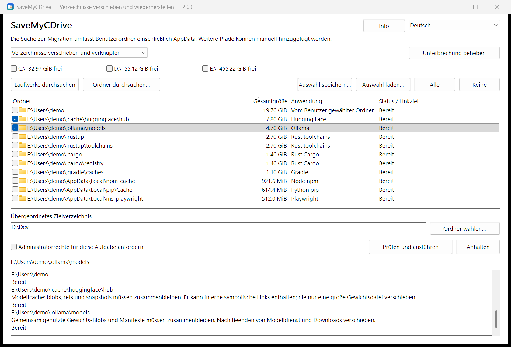

<div align="center">


# SaveMyCDrive

**Ihr Laufwerk C: muss nicht für jeden Standardpfad bezahlen.**<br>
Daten umziehen, Arbeitsumgebung behalten.<br>
**Nichts löschen · Mit einem Klick verschieben · Mit einem Klick zurückholen**

[](https://github.com/suifei/save-my-c-drive/releases/latest)
[](https://github.com/suifei/save-my-c-drive/actions/workflows/ci.yml)

[](#lizenz)

[English](README.md) · [简体中文](README.zh-CN.md) · [繁體中文](README.zh-TW.md) · [日本語](README.ja.md) · [한국어](README.ko.md) · **Deutsch**

</div>

SaveMyCDrive verschiebt die ständig wachsenden Ordner unter `AppData` und in Ihrem Benutzerordner auf ein anderes Laufwerk und hinterlässt am ursprünglichen Pfad eine Verzeichnisverbindung (Junction). Ihre Programme nutzen weiter den gewohnten Pfad, die Daten liegen dort, wo Sie es wollen. Zurück? Ein Klick genügt.

<p align="center"></p>

## Herunterladen und loslegen

Laden Sie `SaveMyCDrive-v<Version>-windows-x64.zip` unter [Releases](https://github.com/suifei/save-my-c-drive/releases/latest) herunter, entpacken Sie es und starten Sie das Programm. Kein Installationsprogramm, keine Laufzeitumgebung nötig.

| Datei | Zweck |
| --- | --- |
| `SaveMyCDrive.exe` | Grafische Oberfläche |
| `smcd.exe` | Kommandozeile mit demselben Kern und denselben Prüfungen |

**In der Oberfläche:**

1. **Durchsuchen.** Laufwerke ankreuzen und *Laufwerke durchsuchen* wählen, oder *Ordner durchsuchen…*. Die Suche liest nur.
2. **Auswählen.** Jede Zeile ist ein erkannter Ordner mit Größe, Anwendung und Status. Nichts ist vorab angekreuzt; graue Zeilen lassen sich gerade nicht verschieben. Eine markierte Zeile zeigt ihre Hinweise im Protokoll.
3. **Ziel wählen.** Ein Zielverzeichnis wie `D:\Dev` eingeben, *Prüfen und ausführen* wählen und jedes `Quelle → Ziel` sowie die Programme prüfen, die diese Ordner gerade verwenden.
4. **Bei Bedarf zurückholen.** Den Modus auf Wiederherstellen umstellen, das Laufwerk mit den Verbindungen durchsuchen, ankreuzen und wiederherstellen.

**Auf der Kommandozeile:**

```powershell
smcd scan --volumes C: --mode migrate --measure --out scan.json
smcd plan --scan scan.json --select <id> --destination D:\Dev --out plan.json
smcd apply --plan plan.json
smcd restore --source C:\Users\You\.cache\huggingface
smcd history
```

`smcd --help` listet alle Befehle; mit `--state PATH` liegen die Transaktionsprotokolle in einem Ordner Ihrer Wahl (portable Nutzung).

## „Ich habe meine Programme auf D: installiert. Warum ist C: schon wieder voll?“

Sie haben im Installer D: gewählt, Projekte liegen woanders, der Papierkorb ist leer. C: ist trotzdem rot.

Ein KI-Werkzeug hat noch ein Modell geladen, der Editor hat Erweiterungen dazubekommen, ein Compiler hat seinen Cache gefüllt, ein Paketmanager hat noch eine Kopie aller Abhängigkeiten angelegt – alles unter `AppData` oder in versteckten Ordnern Ihres Benutzerverzeichnisses. Dann scheitert ein Update, ein Build bricht ab oder ein Download läuft mittendrin voll.

**Ihr Rechner hat Platz. Ihre Werkzeuge wählen nur immer denselben Ort.** Wer sich nicht auskennt, traut sich nicht an fremde Ordner. Wer sich auskennt, kann `mklink` schreiben, muss aber trotzdem jedes Mal Ordner finden, Zugriffe prüfen, Daten verschieben und sich merken, was wohin ging. SaveMyCDrive vereint Finden, Prüfen, Verschieben und Zurückholen in einem Ablauf.

## Verschieben statt löschen: der Vergleich

Aufräumen schafft nur kurz Platz: Gelöschte Caches wachsen nach, Modelle müssen neu geladen werden, und Sitzungsverläufe oder Erweiterungen kann man gar nicht löschen. SaveMyCDrive löscht nichts, es gibt diesen Daten ein Zuhause auf einem anderen Laufwerk.

| | Aufräumprogramme<br>(CCleaner, Speicheroptimierung usw.) | Jedes Mal einen KI-Assistenten / eine KI-Skill fragen | **SaveMyCDrive** |
| --- | --- | --- | --- |
| Vorgehen | Caches und „Müll“ löschen | Die KI untersucht Ordner, entscheidet und führt Befehle sofort aus | Ganze Ordner auf ein anderes Laufwerk, Junction am ursprünglichen Pfad |
| Daten von KI-Coding-Tools<br>(Sitzungen, Modelle, Erweiterungen) | Meist unbekannt: löschen oder ignorieren | Spontan beurteilt; das Ergebnis kann jedes Mal anders sein | 124 eingebaute Regeln erkennen Ort und Anwendungsmerkmale |
| Datenverlust | Gelöscht ist weg; neu laden oder neu erzeugen | Möglich: wichtige Ordner für Cache gehalten | Nichts gelöscht; Quelle erst nach erfolgreicher Kopie geräumt, Stopp bei Resten |
| Ein paar Wochen später | Wächst nach; erneut aufräumen | Wächst nach; erneut die KI fragen | Neue Dateien landen auf dem neuen Laufwerk, nicht auf C: |
| Meinung geändert | Kein Weg zurück | Hängt davon ab, was die KI tatsächlich ausgeführt hat | Ein Klick zurück, inklusive seither hinzugekommener Dateien |
| Stromausfall / Abbruch | — | Halb ausgeführte Befehle sind schwer nachzuvollziehen | Protokolliert; aus dem Protokoll fortsetzen oder zurückrollen |
| Kosten pro Lauf | Kostenlos; manche laufen dauerhaft oder werben | Viele Tokens pro Lauf, schwankende Ergebnisse | Null Tokens, wiederholbar; beendet sich danach, kein Netzwerk |
| Überprüfbar | Closed Source | Prompts lesbar, aber das Modell entscheidet, was läuft | Open Source; Regeln und Ablauf sind festgelegt |

### Warum nicht jedes Mal eine KI aufräumen lassen?

KI ist stark bei einmaligen, unbekannten Problemen. Alle paar Wochen C: freizuräumen ist das Gegenteil: Routine, und Ihre Daten stehen auf dem Spiel.

- **Uneinheitlich.** Derselbe Ordner ist in einer Sitzung „Cache, kann weg“ und in der nächsten „behalten“ – je nach Modell und Frage.
- **Versehentliches Löschen.** `.claude\projects` klingt nach Cache, enthält aber den Sitzungsverlauf von Claude Code. Blobs und Snapshots in `huggingface\hub` verweisen aufeinander; wer nur „die größten Dateien“ löscht, beschädigt Modelle und lädt Dutzende GB neu. Ein vertippter Pfad in `Remove-Item -Recurse` oder `rm -rf` kann den übergeordneten Ordner mitnehmen.
- **Tokenkosten.** Jeder Lauf listet Ordner, summiert Größen und recherchiert; zwei Wochen später ist C: wieder voll, und Sie zahlen erneut.
- **Symptombehandlung.** Was gelöscht wurde, wächst nach.

SaveMyCDrive macht aus diesen Entscheidungen überprüfbare Regeln und einen festen Ablauf: gleiche Eingabe, gleiches Ergebnis, Vorschau vor der Ausführung, Rückweg danach, und es kostet keine Tokens.

## So funktioniert es

| | Pfad, den Ihre Programme nutzen | Wo die Daten liegen |
| --- | --- | --- |
| Vorher | `C:\Users\You\.cache\huggingface` | Auf C: |
| Nachher | Derselbe Pfad, jetzt eine Junction | `D:\Dev\huggingface` |

Es nutzt nur Werkzeuge, die Windows mitbringt:

1. **Prüfen.** Programme, die den Ordner verwenden, werden nach Produktname aufgelistet, damit Sie sie schließen können. SaveMyCDrive beendet nie Prozesse.
2. **Kopieren.** Das System-`robocopy` kopiert mehrkanalig in einen Zwischenordner neben dem Ziel; sein Rückgabewert entscheidet über den Erfolg.
3. **Umschalten.** Die Kopie wird an ihren Platz gesetzt, und `robocopy /MOVE` räumt die Quelle. Bleibt eine Datei zurück, stoppt SaveMyCDrive und behält die Daten.
4. **Verbinden.** Das System-`mklink /J` legt die Junction am ursprünglichen Pfad an.

Jeder Schritt wird protokolliert. Nach Stromausfall oder Abbruch setzt *Unterbrechung beheben* anhand des Protokolls und des tatsächlichen Laufwerkszustands fort oder rollt zurück; das Ergebnis je Ordner und das des ganzen Stapels werden getrennt festgehalten.

## Für die Ordner, die immer weiter wachsen

Ein eingebautes Anwendungswissen (124 Regeln) erkennt Ordner an Ort und Anwendungsmerkmalen, nicht nur am Namen:

| Was ständig wächst | Beispiele |
| --- | --- |
| KI-Werkzeuge und lokale Modelle | Claude Code, Codex, Kimi Code, Cursor, Hugging Face, Ollama, Torch, ModelScope |
| Compiler- und Build-Daten | Rust toolchains / Cargo, Go, vcpkg, C++ IntelliSense |
| Paket-Caches | npm, pip, uv, pnpm, NuGet, Gradle, Playwright |
| Editoren und App-Daten | VS Code, Cursor, Obsidian, WeCom und mehr |

Siehe die [Ordnerliste](docs/application-storage-list.md) (Chinesisch). Ordner mit „Prüfung nötig“ werden angezeigt, aber lesen Sie zuerst ihre Hinweise.

## Sicherheit

- **Die Suche liest nur.** Sie startet nie ein Verschieben, Wiederherstellen, Löschen oder Reparieren.
- **Sie entscheiden.** Kandidaten und alle Optionen sind anfangs aus; vorhandene Zielinhalte werden nie stillschweigend zusammengeführt oder überschrieben.
- **Bei Unsicherheit wird gestoppt.** Fehlgeschlagene Kopien, noch benutzte Ordner, geänderte Identität oder unbekannte Verknüpfungsarten lassen die Daten an Ort und Stelle, mit Begründung.
- **Kein Löschen über Verknüpfungen.** Aufgeräumt wird nur mit `robocopy /MOVE` und dem Entfernen leerer Ordner, nie mit ungeprüftem rekursivem Löschen.
- **Wiederherstellen holt den aktuellen Stand zurück**, einschließlich seit dem Verschieben geänderter Dateien. Auch von Hand angelegte Junctions werden gefunden und können zurückgeholt werden.
- **Alles bleibt lokal.** Keine Telemetrie, kein Netzwerkzugriff, keine Uploads.

## Häufige Fragen

**Brauche ich Administratorrechte?**
Für die schnelle Suche über ganze Laufwerke (NTFS MFT) ja; SaveMyCDrive fragt bei Bedarf per UAC und weicht bei Ablehnung auf die normale Suche aus. Für Benutzerordner meist nicht.

**Funktioniert danach jedes Programm?**
Den ursprünglichen Pfad zu behalten ist die Methode, keine Kompatibilitätsgarantie für jedes Programm. Updater, Berechtigungen und Ordnerinhalte spielen mit; bekannte Einschränkungen stehen in der Liste und im Protokoll.

**Welche Laufwerke werden unterstützt?**
Lokale NTFS-Volumes. Netzwerkpfade und andere Dateisysteme nicht. Das Ziel braucht genug Platz und muss erreichbar sein, solange Programme die Daten nutzen.

## Sprache der Oberfläche

Gepflegt wird vereinfachtes Chinesisch. Englisch, traditionelles Chinesisch, Japanisch, Koreanisch und Deutsch sind verfügbar, neue Texte werden aber nicht mehr übersetzt; fehlende Texte erscheinen auf Englisch.

## Entwicklung

Anforderungen, Entwurf und Prüfung stehen in [docs/](docs/) (Chinesisch). In Rust geschrieben; CLI und native Win32-Oberfläche teilen einen Kern.

Wenn SaveMyCDrive hilft, hilft ein **Star** der nächsten Person mit vollem Laufwerk C:, es zu finden.

## Kontakt

- QQ: 410000
- Fehler und Vorschläge: [GitHub Issues](https://github.com/suifei/save-my-c-drive/issues)

## Lizenz

Nach Ihrer Wahl unter [MIT](LICENSE-MIT) oder [Apache-2.0](LICENSE-APACHE). Die Hinweise der Abhängigkeiten liegen dem Release-Archiv bei (`third-party-notices/`).
