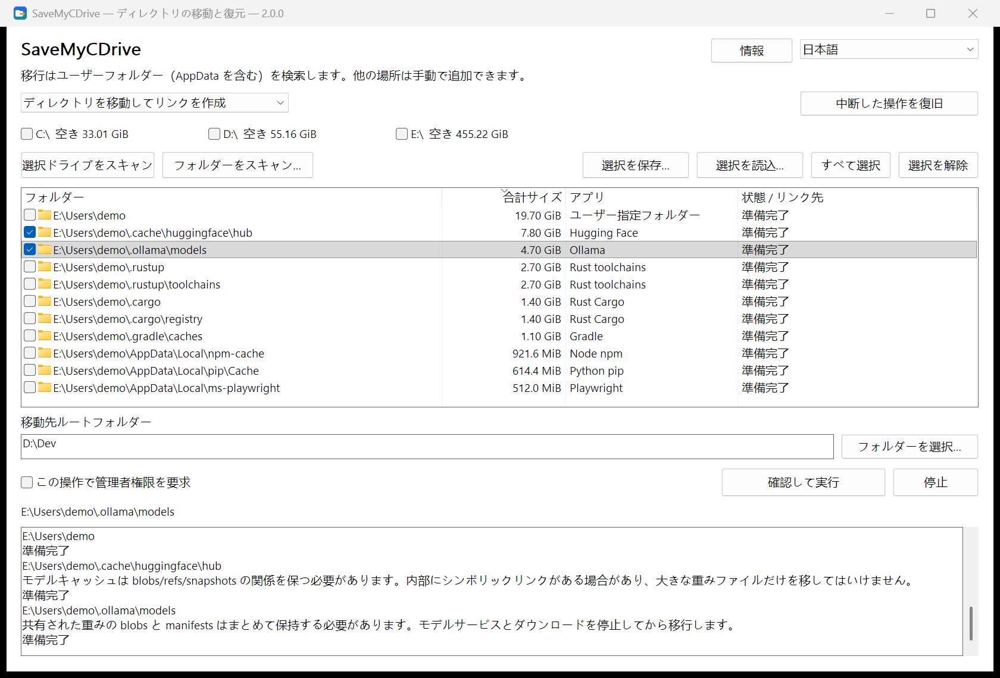

<div align="center">


# SaveMyCDrive

**C ドライブを、既定の保存先の犠牲にしない。**<br>
データは別のドライブへ、作業環境はそのままに。<br>
**データを消さない · ワンクリックで移行 · ワンクリックで復元**

[](https://github.com/suifei/save-my-c-drive/releases/latest)
[](https://github.com/suifei/save-my-c-drive/actions/workflows/ci.yml)

[](#ライセンス)

[English](README.md) · [简体中文](README.zh-CN.md) · [繁體中文](README.zh-TW.md) · **日本語** · [한국어](README.ko.md) · [Deutsch](README.de.md)

</div>

SaveMyCDrive は、`AppData` やユーザーフォルダーの中で膨らみ続けるフォルダーを別のドライブへ移し、元の場所にディレクトリ ジャンクションを残します。アプリはこれまでどおり元のパスを使い、データは選んだ場所に置かれます。戻したくなったらワンクリックで復元できます。

<p align="center"></p>

## ダウンロードと使い方

[Releases](https://github.com/suifei/save-my-c-drive/releases/latest) から `SaveMyCDrive-v<バージョン>-windows-x64.zip` をダウンロードし、展開して実行します。インストールもランタイムも不要です。

| ファイル | 用途 |
| --- | --- |
| `SaveMyCDrive.exe` | グラフィカル画面 |
| `smcd.exe` | コマンドライン（画面と同じコアとチェックを使用） |

**画面での 4 ステップ：**

1. **スキャン**：ドライブにチェックを入れて「選択ドライブをスキャン」、または「フォルダーをスキャン…」。スキャンは読み取りのみで、何も変更しません。
2. **選択**：各行は認識されたフォルダーで、サイズ、アプリ、状態を表示します。最初はどれもチェックされていません。灰色の行は現在移行できません。行を選ぶと下のログに説明が出ます。
3. **移行先を選ぶ**：`D:\Dev` などの移行先ルートを入力し、「確認して実行」を押して、各「元のパス → 移行先」と、そのフォルダーを使用中のプログラムを確認します。
4. **必要なら復元**：モードをリンクの復元に切り替え、ジャンクションのあるドライブをスキャンし、チェックして復元します。

**コマンドラインの例：**

```powershell
smcd scan --volumes C: --mode migrate --measure --out scan.json
smcd plan --scan scan.json --select <id> --destination D:\Dev --out plan.json
smcd apply --plan plan.json
smcd restore --source C:\Users\You\.cache\huggingface
smcd history
```

`smcd --help` で全コマンドを表示します。`--state PATH` でトランザクション記録を任意のフォルダーに置けます（ポータブル利用）。

## 「アプリは D ドライブに入れたのに、なぜ C ドライブがまた一杯に？」

インストール時に D ドライブを選び、プロジェクトも別ドライブに置き、ごみ箱も空にした。それでも C ドライブは赤いまま。

AI ツールがまたモデルをダウンロードし、エディターに拡張機能が増え、コンパイラーがキャッシュを作り、パッケージマネージャーが依存関係をもう一部ため込む。どれも `AppData` やユーザーフォルダーのドットで始まるフォルダーの中です。そしてある日、更新が失敗し、ビルドが止まり、ダウンロードが途中で容量不足になります。

**空き容量はあるのに、ツールがいつも同じ場所を選ぶだけ。** 慣れていない人は知らないフォルダーに触れるのが怖く、慣れた人は `mklink` を書けても、フォルダー探し、使用中の確認、データの移動、どこへ移したかの記録を毎回手作業で繰り返すことになります。SaveMyCDrive は、発見・確認・移行・復元を一つの流れにまとめます。

## 消さずに引っ越す：他の方法との比較

掃除で空くのは一時的です。消したキャッシュはまた増え、モデルは再ダウンロードが必要になり、セッション履歴や拡張機能はそもそも消せません。SaveMyCDrive は何も消さず、データの置き場所を別のドライブに移します。

| | クリーナー<br>（CCleaner、ストレージ センサーなど） | 毎回 AI アシスタント / AI スキルに頼む | **SaveMyCDrive** |
| --- | --- | --- | --- |
| 方法 | キャッシュや「ゴミ」を削除 | AI がその場でフォルダーを調べ、判断し、コマンドを実行 | フォルダーごと別ドライブへ移し、元のパスにジャンクション |
| AI コーディングツールのデータ<br>（セッション、モデル、拡張機能） | ほぼ認識されず、消すか放置 | その場の判断で、結論が毎回変わりうる | 124 の内蔵ルールがパスとアプリの目印で識別 |
| データ損失 | 消したら終わり。再ダウンロードか再生成 | 起こりうる。重要なフォルダーをキャッシュと誤認 | 削除なし。コピー成功後にだけ元を片付け、残りがあれば停止 |
| 数週間後 | また増えて、また掃除 | また増えて、また AI に依頼 | 新しいファイルは新しいドライブに書かれ、C には溜まらない |
| 気が変わったら | 戻せない | AI が実際に何を実行したか次第 | ワンクリックで復元。移行後に増えた分も一緒に戻る |
| 停電・中断 | — | 途中まで実行したコマンドは追跡が難しい | トランザクションログから続行またはロールバック |
| 1 回あたりのコスト | 無料。常駐や広告のある製品も | 毎回大量のトークン、結果も不安定 | トークン不要で再現可能。終われば終了し、通信しない |
| 検証できるか | クローズドソース | プロンプトは読めるが、実行内容はモデル次第 | オープンソース。ルールと手順は固定で確認可能 |

### なぜ毎回 AI に掃除を頼まないのか

AI は一度きりの未知の問題には強い一方、「定期的に C ドライブを空ける」のは繰り返し作業で、しかもデータの安全がかかっています。

- **不安定**：同じフォルダーでも、あるときは「消してよいキャッシュ」、モデルや聞き方が変わると「残すべき」になります。
- **誤削除**：`.claude\projects` はキャッシュのような名前ですが、Claude Code のセッション履歴です。`huggingface\hub` の blobs と snapshots は互いに参照しており、「一番大きいファイル」だけ消すとモデルが壊れ、数十 GB の再ダウンロードになります。パスを 1 文字間違えた `Remove-Item -Recurse` や `rm -rf` は親フォルダーごと消しかねません。
- **トークンの浪費**：毎回フォルダー一覧、サイズ計算、調べ物をさせ、2 週間後に C ドライブがまた一杯になれば、また支払います。
- **対症療法**：消したものはまた増えます。

SaveMyCDrive はこれらの判断を、確認できるルールと固定の手順にしました。同じ入力には同じ結果、実行前にプレビュー、実行後にロールバックでき、トークンも使いません。

## 仕組み

| | アプリが使うパス | データの実際の場所 |
| --- | --- | --- |
| 移行前 | `C:\Users\You\.cache\huggingface` | C ドライブ |
| 移行後 | 同じパス（ジャンクションになる） | `D:\Dev\huggingface` |

Windows に最初から入っているツールだけを使います。

1. **確認**：フォルダーを使用中のプログラムを製品名で一覧表示し、閉じてもらいます。SaveMyCDrive がプロセスを終了することはありません。
2. **コピー**：システムの `robocopy` がマルチスレッドで移行先の隣の一時フォルダーへコピーし、終了コードで成否を判断します。
3. **切り替え**：一時フォルダーを所定の位置に置き、`robocopy /MOVE` で元のフォルダーを片付けます。ファイルが一つでも残れば停止し、データを保持します。
4. **リンク**：システムの `mklink /J` で元のパスにジャンクションを作成します。

各ステップはトランザクションログに記録されます。停電や中断の後は「中断した操作を復旧」で、ログと実際のディスクの状態から続行またはロールバックします。フォルダーごとの結果とバッチ全体の結果は別々に記録されます。

## 膨らみ続けるフォルダーに注目

内蔵のアプリ知識パック（124 ルール）は、名前だけでなく場所とアプリの目印でフォルダーを識別します。

| 増え続けるもの | 例 |
| --- | --- |
| AI ツールとローカルモデル | Claude Code、Codex、Kimi Code、Cursor、Hugging Face、Ollama、Torch、ModelScope |
| コンパイラーとビルドのデータ | Rust toolchains / Cargo、Go、vcpkg、C++ IntelliSense |
| パッケージのキャッシュ | npm、pip、uv、pnpm、NuGet、Gradle、Playwright |
| エディターとアプリのデータ | VS Code、Cursor、Obsidian、WeCom など |

一覧は[フォルダーリスト](docs/application-storage-list.md)（中国語）を参照してください。「要確認」のフォルダーも表示されますが、先に説明を読んでください。

## 安全性

- **スキャンは読み取りのみ**。移行、復元、削除、修復を始めることはありません。
- **決めるのはあなた**：候補もオプションもすべて最初はオフ。移行先の既存内容を黙って統合・上書きしません。
- **確信が持てなければ止まる**：コピー失敗、使用中、識別情報の変化、未知のリンク種別では、データを残して理由を表示します。
- **リンク越しに削除しない**：片付けは `robocopy /MOVE` と空フォルダーの削除のみ。未検証の再帰削除は行いません。
- **復元は現在の内容を戻す**：移行後に追加・変更したファイルも含みます。手作業で作ったジャンクションも検出・復元できます。
- **すべてローカル**：テレメトリなし、通信なし、アップロードなし。

## よくある質問

**管理者権限は必要？**
ドライブ全体の高速スキャン（NTFS MFT）には必要です。必要なときに UAC で確認し、拒否すると通常のスキャンに切り替えます。ユーザーフォルダーの移行には通常不要です。

**移行後、どのアプリも動く？**
元のパスを保つのは移行の手法であり、あらゆるアプリの互換性を保証するものではありません。アップデーター、権限、フォルダーの中身が影響します。既知の制限は一覧とログに表示されます。

**対応ドライブは？**
ローカルの NTFS ボリュームです。ネットワークパスや他のファイルシステムは対象外です。移行先には十分な空きが必要で、アプリがデータを使う間は接続しておく必要があります。

## 表示言語

継続的に保守しているのは簡体字中国語です。英語、繁体字中国語、日本語、韓国語、ドイツ語も使えますが、新しい文言は翻訳されず、不足分は英語で表示されます。

## 開発

要件、設計、検証は [docs/](docs/)（中国語）にあります。Rust 製で、CLI とネイティブ Win32 GUI が同じコアを共有します。

役に立ったら **Star** をお願いします。次に C ドライブが一杯になった人が見つけやすくなります。

## 連絡先

- QQ：410000
- 問題・提案：[GitHub Issues](https://github.com/suifei/save-my-c-drive/issues)

## ライセンス

[MIT](LICENSE-MIT) または [Apache-2.0](LICENSE-APACHE) のいずれかを選択できます。依存関係の著作権表示はリリースアーカイブに同梱されています（`third-party-notices/`）。
