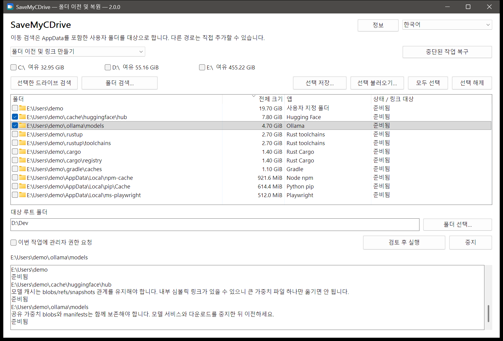

<div align="center">


# SaveMyCDrive

**C 드라이브가 모든 기본 저장 위치의 대가를 치를 필요는 없습니다.**<br>
데이터는 다른 드라이브로, 작업 환경은 그대로.<br>
**데이터는 지우지 않고 · 원클릭 이전 · 원클릭 복원**

[](https://github.com/suifei/save-my-c-drive/releases/latest)
[](https://github.com/suifei/save-my-c-drive/actions/workflows/ci.yml)

[](#라이선스)

[English](README.md) · [简体中文](README.zh-CN.md) · [繁體中文](README.zh-TW.md) · [日本語](README.ja.md) · **한국어** · [Deutsch](README.de.md)

</div>

SaveMyCDrive는 `AppData`와 사용자 폴더 안에서 계속 커지는 폴더를 다른 드라이브로 옮기고, 원래 위치에 디렉터리 정션(junction)을 남깁니다. 앱은 지금처럼 원래 경로를 쓰고, 데이터는 선택한 곳에 저장됩니다. 되돌리고 싶으면 원클릭으로 복원하세요.

<p align="center"></p>

## 다운로드와 사용법

[Releases](https://github.com/suifei/save-my-c-drive/releases/latest)에서 `SaveMyCDrive-v<버전>-windows-x64.zip`을 받아 압축을 풀고 실행하세요. 설치 프로그램도, 따로 설치할 런타임도 없습니다.

| 파일 | 용도 |
| --- | --- |
| `SaveMyCDrive.exe` | 그래픽 화면 |
| `smcd.exe` | 명령줄(화면과 같은 코어와 검사 사용) |

**화면에서 4단계:**

1. **검색**: 드라이브를 체크하고 「선택한 드라이브 검색」 또는 「폴더 검색…」을 누릅니다. 검색은 읽기 전용이며 아무것도 바꾸지 않습니다.
2. **선택**: 각 행은 인식된 폴더이며 크기, 앱, 상태를 보여 줍니다. 처음에는 아무것도 체크되어 있지 않고, 회색 행은 지금 이전할 수 없습니다. 행을 선택하면 아래 로그에 설명이 나옵니다.
3. **대상 선택**: `D:\Dev` 같은 대상 루트를 입력하고 「검토 후 실행」을 눌러 각 「원래 경로 → 대상」과 해당 폴더를 사용 중인 프로그램을 확인합니다.
4. **필요하면 복원**: 모드를 링크 복원으로 바꾸고 정션이 있는 드라이브를 검색한 뒤 체크해서 복원합니다.

**명령줄 예시:**

```powershell
smcd scan --volumes C: --mode migrate --measure --out scan.json
smcd plan --scan scan.json --select <id> --destination D:\Dev --out plan.json
smcd apply --plan plan.json
smcd restore --source C:\Users\You\.cache\huggingface
smcd history
```

`smcd --help`는 모든 명령을 보여 줍니다. `--state PATH`로 트랜잭션 기록을 원하는 폴더에 둘 수 있습니다(휴대용 사용).

## 「앱은 D 드라이브에 설치했는데 왜 C 드라이브가 또 꽉 찼을까?」

설치할 때 D 드라이브를 골랐고, 프로젝트도 다른 드라이브에 두고, 휴지통도 비웠습니다. 그래도 C 드라이브는 빨간색입니다.

AI 도구가 모델을 또 내려받고, 편집기에는 확장이 늘고, 컴파일러는 캐시를 만들고, 패키지 관리자는 의존성 사본을 또 하나 쌓습니다. 모두 `AppData`나 사용자 폴더의 점으로 시작하는 폴더 안에 있습니다. 그러다 업데이트가 실패하고, 빌드가 멈추고, 다운로드가 중간에 공간 부족으로 끊깁니다.

**컴퓨터에는 공간이 있습니다. 도구들이 늘 같은 곳을 고를 뿐입니다.** 익숙하지 않은 사람은 모르는 폴더를 건드리기 겁나고, 익숙한 사람은 `mklink`를 쓸 줄 알아도 폴더 찾기, 사용 중인지 확인, 데이터 이동, 어디로 옮겼는지 기억하기를 매번 손으로 반복해야 합니다. SaveMyCDrive는 찾기, 검토, 이전, 복원을 하나의 흐름으로 묶습니다.

## 지우지 말고 옮기기: 다른 방법과 비교

정리로 얻는 공간은 잠시뿐입니다. 지운 캐시는 다시 자라고, 모델은 다시 받아야 하며, 세션 기록이나 확장은 아예 지울 수 없습니다. SaveMyCDrive는 아무것도 지우지 않고 데이터를 다른 드라이브에 둡니다.

| | 디스크 정리 도구<br>(CCleaner, 저장소 센스 등) | 매번 AI 어시스턴트 / AI 스킬에 맡기기 | **SaveMyCDrive** |
| --- | --- | --- | --- |
| 방식 | 캐시와 「쓰레기」 삭제 | AI가 그 자리에서 폴더를 살피고 판단해 명령 실행 | 폴더째 다른 드라이브로 옮기고 원래 경로에 정션 |
| AI 코딩 도구 데이터<br>(세션, 모델, 확장) | 대부분 인식 못 함: 지우거나 무시 | 즉석 판단이라 결론이 매번 달라질 수 있음 | 내장 규칙 124개가 경로와 앱 표지로 식별 |
| 데이터 손실 | 지우면 끝. 다시 받거나 다시 생성 | 가능함. 중요한 폴더를 캐시로 오인 | 삭제 없음. 복사 성공 후에만 원본 정리, 남은 파일이 있으면 중지 |
| 몇 주 뒤 | 다시 자라서 또 정리 | 다시 자라서 또 AI에 요청 | 새 파일은 새 드라이브에 쓰이고 C에는 쌓이지 않음 |
| 마음이 바뀌면 | 되돌릴 수 없음 | AI가 실제로 무엇을 실행했는지에 달림 | 원클릭 복원, 이전 후 추가된 파일도 함께 |
| 정전·중단 | — | 중간까지 실행된 명령은 추적하기 어려움 | 트랜잭션 로그로 계속하거나 되돌림 |
| 1회 비용 | 무료, 일부는 상주하거나 광고 | 매번 많은 토큰, 결과도 들쭉날쭉 | 토큰 0, 결과 재현 가능. 끝나면 종료, 네트워크 없음 |
| 검증 가능성 | 비공개 소스 | 프롬프트는 읽을 수 있으나 실행은 모델이 결정 | 오픈 소스, 규칙과 절차가 고정되어 확인 가능 |

### 왜 매번 AI에게 정리를 맡기지 않을까?

AI는 한 번뿐인 낯선 문제에 강합니다. 하지만 「주기적으로 C 드라이브 공간 확보」는 반복 작업이고, 데이터 안전이 걸려 있습니다.

- **불안정**: 같은 폴더도 이번에는 「지워도 되는 캐시」, 모델이나 질문이 바뀌면 「보존」이 될 수 있습니다.
- **잘못된 삭제**: `.claude\projects`는 캐시처럼 보이지만 Claude Code의 세션 기록입니다. `huggingface\hub`의 blobs와 snapshots는 서로 참조하므로 「가장 큰 파일」만 지우면 모델이 망가지고 수십 GB를 다시 받아야 합니다. 경로를 잘못 쓴 `Remove-Item -Recurse`나 `rm -rf` 한 줄이면 상위 폴더까지 지울 수 있습니다.
- **토큰 낭비**: 매번 폴더 목록, 크기 계산, 자료 조사를 시키고, 2주 뒤 C 드라이브가 또 차면 또 비용을 냅니다.
- **임시방편**: 지운 것은 다시 자랍니다.

SaveMyCDrive는 이런 판단을 검토 가능한 규칙과 고정된 절차로 만들었습니다. 같은 입력이면 같은 결과, 실행 전 미리 보기, 실행 후 되돌리기가 가능하며 토큰도 들지 않습니다.

## 작동 방식

| | 앱이 쓰는 경로 | 데이터의 실제 위치 |
| --- | --- | --- |
| 이전 전 | `C:\Users\You\.cache\huggingface` | C 드라이브 |
| 이전 후 | 같은 경로(정션이 됨) | `D:\Dev\huggingface` |

Windows에 기본으로 들어 있는 도구만 사용합니다.

1. **확인**: 폴더를 사용 중인 프로그램을 제품 이름별로 보여 주고 닫아 달라고 요청합니다. SaveMyCDrive는 프로세스를 강제로 끝내지 않습니다.
2. **복사**: 시스템 `robocopy`가 다중 스레드로 대상 옆의 임시 폴더에 복사하고, 종료 코드로 성공 여부를 판단합니다.
3. **전환**: 임시 폴더를 제자리에 두고 `robocopy /MOVE`로 원본을 정리합니다. 파일이 하나라도 남으면 멈추고 데이터를 보존합니다.
4. **연결**: 시스템 `mklink /J`가 원래 경로에 정션을 만듭니다.

모든 단계는 트랜잭션 로그에 기록됩니다. 정전이나 중단 후에는 「중단된 작업 복구」가 로그와 실제 디스크 상태를 보고 계속하거나 되돌립니다. 폴더별 결과와 일괄 작업 결과는 따로 기록됩니다.

## 계속 커지는 폴더에 집중

내장 앱 지식 팩(규칙 124개)은 이름만이 아니라 위치와 앱 표지로 폴더를 식별합니다.

| 계속 커지는 것 | 예 |
| --- | --- |
| AI 도구와 로컬 모델 | Claude Code, Codex, Kimi Code, Cursor, Hugging Face, Ollama, Torch, ModelScope |
| 컴파일러와 빌드 데이터 | Rust toolchains / Cargo, Go, vcpkg, C++ IntelliSense |
| 패키지 캐시 | npm, pip, uv, pnpm, NuGet, Gradle, Playwright |
| 편집기와 앱 데이터 | VS Code, Cursor, Obsidian, WeCom 등 |

[폴더 목록](docs/application-storage-list.md)(중국어)을 참고하세요. 「확인 필요」로 표시된 폴더도 보이지만, 먼저 설명을 읽어야 합니다.

## 안전

- **검색은 읽기 전용**입니다. 이전, 복원, 삭제, 복구를 시작하지 않습니다.
- **결정은 사용자가**: 후보와 모든 옵션은 처음에 꺼져 있습니다. 대상의 기존 내용을 몰래 합치거나 덮어쓰지 않습니다.
- **확실하지 않으면 멈춤**: 복사 실패, 사용 중, 식별 정보 변경, 알 수 없는 링크 유형이면 데이터를 그대로 두고 이유를 알려 줍니다.
- **링크를 따라 지우지 않음**: 정리는 `robocopy /MOVE`와 빈 폴더 삭제뿐이며, 검증되지 않은 재귀 삭제는 하지 않습니다.
- **복원은 현재 내용을 되돌림**: 이전 후 추가·수정된 파일도 포함합니다. 직접 만든 정션도 찾아서 복원할 수 있습니다.
- **모두 로컬에서**: 원격 분석 없음, 네트워크 없음, 업로드 없음.

## 자주 묻는 질문

**관리자 권한이 필요한가요?**
드라이브 전체 빠른 검색(NTFS MFT)에는 필요합니다. 필요할 때 UAC로 묻고, 거절하면 일반 검색으로 전환합니다. 사용자 폴더 이전에는 보통 필요 없습니다.

**이전 후 모든 앱이 동작하나요?**
원래 경로를 유지하는 것은 이전 방법일 뿐, 모든 앱의 호환성을 보장하지는 않습니다. 업데이터, 권한, 폴더 내용이 영향을 줍니다. 알려진 제한은 목록과 로그에 표시됩니다.

**어떤 드라이브를 지원하나요?**
로컬 NTFS 볼륨입니다. 네트워크 경로와 다른 파일 시스템은 대상이 아닙니다. 대상에는 충분한 공간이 있어야 하고, 앱이 데이터를 쓰는 동안 연결되어 있어야 합니다.

## 표시 언어

꾸준히 관리되는 언어는 중국어 간체입니다. 영어, 중국어 번체, 일본어, 한국어, 독일어도 사용할 수 있지만 새 문구는 번역되지 않으며, 없는 문구는 영어로 표시됩니다.

## 개발

요구 사항, 설계, 검증 문서는 [docs/](docs/)(중국어)에 있습니다. Rust로 작성했고 CLI와 네이티브 Win32 GUI가 같은 코어를 공유합니다.

도움이 되었다면 **Star**를 눌러 주세요. 다음에 C 드라이브가 꽉 찬 사람이 더 쉽게 찾을 수 있습니다.

## 연락처

- QQ: 410000
- 문제와 제안: [GitHub Issues](https://github.com/suifei/save-my-c-drive/issues)

## 라이선스

[MIT](LICENSE-MIT) 또는 [Apache-2.0](LICENSE-APACHE) 중 하나를 선택해 사용할 수 있습니다. 의존성의 저작권 고지는 릴리스 압축 파일에 포함되어 있습니다(`third-party-notices/`).
