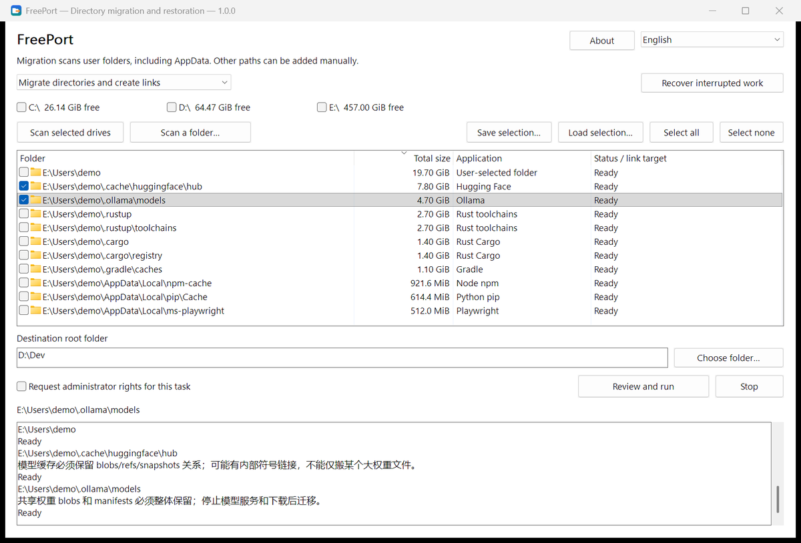

<div align="center">


# FreePort

**Set your C: drive free.**<br>
Move your data. Keep your workflow.

[](https://github.com/suifei/freeport/releases/latest)
[](https://github.com/suifei/freeport/actions/workflows/ci.yml)

[](#license)

**English** · [简体中文](README.zh-CN.md)

</div>

FreePort moves the space-hungry folders under `AppData` and your home directory to another drive, then leaves a directory junction at the original path. Your apps keep using the path they know while the data lives where you chose. Want it back? Restore it.

<p align="center"></p>

## Download and use

Get `FreePort-v1.0.0-windows-x64.zip` from [Releases](https://github.com/suifei/freeport/releases/latest), unzip, and run. No installer and no runtime to install.

| File | Purpose |
| --- | --- |
| `freeport.exe` | Graphical interface |
| `fp.exe` | Command line, sharing the same core and checks |

**In the GUI:**

1. **Scan.** Tick drives and choose *Scan selected drives*, or *Scan a folder…*. Scanning is read-only.
2. **Select.** Each row is a recognized folder with its size, application and status. Nothing starts checked; grayed rows cannot be moved right now. Select a row to see its notes in the log.
3. **Choose a destination.** Enter a destination root such as `D:\Dev`, choose *Review and run*, and check each `source → destination` and the programs currently using those folders.
4. **Restore when needed.** Switch the mode to restoring links, scan the drive holding the junctions, check them, and restore.

**From the command line:**

```powershell
fp scan --volumes C: --mode migrate --measure --out scan.json
fp plan --scan scan.json --select <id> --destination D:\Dev --out plan.json
fp apply --plan plan.json
fp restore --source C:\Users\You\.cache\huggingface
fp history
```

`fp --help` lists every command; `--state PATH` keeps transaction records in a folder you choose (portable use).

## “I installed my apps on D:. Why is C: full again?”

You picked D: in the installer, keep projects elsewhere, and emptied the Recycle Bin. C: is still red.

An AI tool downloaded another model. Your editor added extensions. A compiler built its cache, and a package manager kept its own copy of everything, all under `AppData` or hidden folders in your home directory. Then an update fails, a build stops, or a download runs out of room halfway.

**Your computer has room. Your tools just keep choosing the same place.** If you're new to this, unfamiliar folders are scary to touch. If you're experienced, you can write `mklink`, but you still have to find folders, check what's using them, move data and remember what went where, every time. FreePort puts discovery, review, migration and restoration in one flow.

## How it works

| | Path your apps use | Where the data lives |
| --- | --- | --- |
| Before | `C:\Users\You\.cache\huggingface` | On C: |
| After | Same path, now a junction | `D:\Dev\huggingface` |

It relies on the tools Windows already ships:

1. **Check.** Programs using the folder are listed by product name so you can close them. FreePort never ends processes.
2. **Copy.** The system `robocopy` copies, multi-threaded, into a staging folder next to the destination; its exit code decides success.
3. **Switch.** The staged copy takes its place and `robocopy /MOVE` retires the source. If any file is left behind, FreePort stops and keeps the data.
4. **Link.** The system `mklink /J` creates the junction at the original path.

Every step is journaled. After a power loss or interruption, *Recover interrupted work* continues or rolls back from the journal and the actual disk state; each folder's result and the batch result are recorded separately.

## Built around the folders that keep growing

A built-in application knowledge pack (124 rules) recognizes folders by location and application markers, not by name alone:

| What keeps growing | Examples |
| --- | --- |
| AI tools and local models | Claude Code, Codex, Kimi Code, Cursor, Hugging Face, Ollama, Torch, ModelScope |
| Compiler and build data | Rust toolchains / Cargo, Go, vcpkg, C++ IntelliSense |
| Package caches | npm, pip, uv, pnpm, NuGet, Gradle, Playwright |
| Editors and app data | VS Code, Cursor, Obsidian, WeCom and more |

See the [directory list](docs/application-storage-list.md) (Chinese). Folders marked for review are listed, but you should read their notes first.

## Safety

- **Scanning is read-only.** It never starts a migration, restoration, deletion or repair.
- **You decide.** Candidates and every optional switch start off; existing destination content is never silently merged or overwritten.
- **Uncertainty stops the operation.** Failed copies, folders still in use, identity changes or unknown link types keep the data in place and explain why.
- **No deleting through links.** Cleanup is `robocopy /MOVE` plus empty-directory removal; never an unverified recursive delete.
- **Restore brings back current files**, including changes made since migration. Junctions you created by hand are found and restorable too.
- **Everything stays local.** No telemetry, no network access, no uploads.

## FAQ

**Do I need administrator rights?**
Whole-drive fast scanning (NTFS MFT) does; FreePort asks via UAC when needed and falls back to a normal scan if you decline. Migrating user folders usually doesn't.

**Will every app work after migration?**
Keeping the original path is the method, not a universal compatibility guarantee. Updaters, permissions and folder contents all matter; known restrictions are shown in the list and log.

**Which drives are supported?**
Local NTFS volumes. Network paths and other filesystems are out of scope. The destination needs enough space and must stay available while apps use the data.

**How fast is it?**
Scanning reads NTFS MFT/USN directly; copying uses `robocopy /MT:8`. Real time depends on data size and disk speed.

## Interface language

Simplified Chinese is the maintained interface language. English, Traditional Chinese, Japanese, Korean and German remain available but are not updated for new text; missing strings fall back to English.

## Development

See the [requirements](docs/requirements.md), [technical design](docs/technical-design.md), [system command contract](docs/system-command-backend.md), [build and validation](docs/development.md) and [implementation status](docs/implementation-status.md) (Chinese). Written in Rust; the CLI and the native Win32 GUI share one core. Repository conventions are in [AGENTS.md](AGENTS.md).

If FreePort helps, a **Star** helps the next person with a full C: drive find it.

## License

Licensed under either of [MIT](LICENSE-MIT) or [Apache-2.0](LICENSE-APACHE), at your option. Dependency notices ship with the release archive (`third-party-notices/`).
