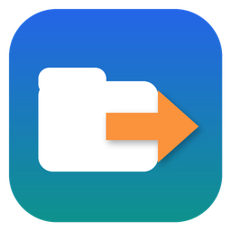
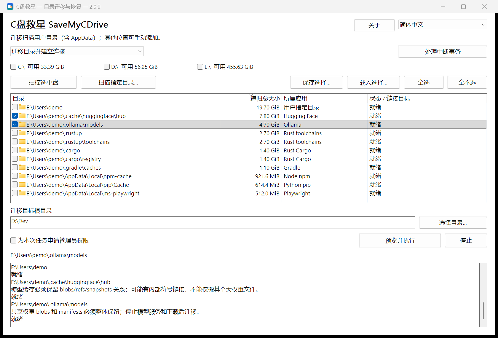

<div align="center">



# C盘救星 · SaveMyCDrive

**你的 C 盘，不该替所有默认设置买单。**<br>
把数据搬走，把工作环境留下。<br>
**不删数据 · 一键迁移 · 一键恢复**

[](https://github.com/suifei/save-my-c-drive/releases/latest)
[](https://github.com/suifei/save-my-c-drive/actions/workflows/ci.yml)

[](#许可证)

[English](README.md) · **简体中文**

</div>

C盘救星把 `AppData`、用户目录里那些越长越大的文件夹搬到其他盘，并在原位置留下目录连接（junction）。软件照旧按原路径访问，数据实际住在你选的地方；想搬回来，一键恢复。

<p align="center"></p>

## 下载与使用

到 [Releases](https://github.com/suifei/save-my-c-drive/releases/latest) 下载 `SaveMyCDrive-v<版本>-windows-x64.zip`，解压即用，无需安装，也不依赖任何运行库。

| 文件 | 用途 |
| --- | --- |
| `SaveMyCDrive.exe` | 图形界面 |
| `smcd.exe` | 命令行，与图形界面共用同一核心和检查 |

**图形界面四步：**

1. **扫描**：勾选磁盘点「扫描选中盘」，或「扫描指定目录…」。扫描只读，不会改动任何东西。
2. **勾选**：列表每行是一个识别出的目录，显示大小、所属应用和状态；默认不勾选，灰色行表示当前不能迁移，选中一行可在下方日志看到说明。
3. **选择去处**：填写迁移目标根目录（如 `D:\Dev`），点「预览并执行」，逐项核对「原路径 → 目标路径」以及正在使用这些目录的程序。
4. **需要时恢复**：模式切到「扫描连接并恢复真实目录」，扫描连接所在的盘，勾选后恢复。

**命令行示例：**

```powershell
smcd scan --volumes C: --mode migrate --measure --out scan.json
smcd plan --scan scan.json --select <id> --destination D:\Dev --out plan.json
smcd apply --plan plan.json
smcd restore --source C:\Users\You\.cache\huggingface
smcd history
```

`smcd --help` 列出全部命令；`--state PATH` 可把事务记录放到指定目录（便携使用）。

## 「我明明把软件装在 D 盘，怎么 C 盘又满了？」

装软件时特意选了 D 盘，项目放在别的盘，下载目录也改了，C 盘还是红了。

AI 工具又下载了一个模型，编辑器又装了几个扩展，编译器攒了一轮缓存，包管理器又留了一份依赖。它们藏在 `AppData`、藏在用户目录里那些点开头的文件夹，平时谁也不会去看。直到系统更新失败、编译报错、模型下载到最后提示空间不足。

**电脑有空间，软件却总往同一个地方塞。** 新手不敢乱动不认识的目录；老手会写 `mklink`，但找目录、查占用、搬数据、记住每个目录搬去了哪里，仍得一遍遍手工来。C盘救星把发现、预览、迁移和恢复放进同一个流程。

## 不删，搬家：和其他做法比

清理只能腾出一时的空间：删掉的缓存会长回来，下载过的模型还得再下，而会话记录、扩展这些数据根本不能删。C盘救星不删任何数据，只给它们换个盘存放。

| | 清理软件<br>（360、电脑管家、CCleaner、存储感知等） | 每次让 AI 助手 / AI 技能来处理 | **C盘救星** |
| --- | --- | --- | --- |
| 做法 | 删除缓存和"垃圾" | AI 现场查目录、判断、执行命令 | 整个目录搬到其他盘，原路径留目录连接 |
| AI 编程工具的数据<br>（会话、模型、扩展） | 基本不认识，只能删或不管 | AI 当场判断，每次结论可能不同 | 124 条内置规则按路径和应用标志识别 |
| 会不会丢数据 | 删除即消失，只能重新下载或生成 | 可能误删，把重要目录当成缓存 | 不删；复制成功才清理原目录，有残留就停下 |
| 过段时间 | 又长回来，要再清 | 又长回来，要再让 AI 来一遍 | 新文件直接写到新盘，不再占 C 盘 |
| 后悔了 | 找不回来 | 取决于 AI 当时执行了什么 | 一键恢复，连迁移后新增的内容一起搬回 |
| 中途断电或中断 | — | 执行到一半的命令难以追溯 | 事务日志，按日志继续或回退 |
| 每次的成本 | 免费，部分产品常驻后台、带推广 | 每次消耗大量 token，结果不稳定 | 零 token，结果可重复；跑完即退，不联网 |
| 能否审查 | 闭源 | 提示词可读，执行由模型临场决定 | 开源，规则和流程都固定可查 |

部分清理软件也提供"C 盘搬家"，但可搬范围由厂商列表决定，一般不覆盖 AI 编程工具的目录。

### 为什么不让 AI 每次帮你清理？

AI 很擅长处理一次性的、没见过的问题，但"定期给 C 盘腾空间"恰恰是重复的、关乎数据安全的事：

- **不稳定**：同一个目录，这次 AI 说是缓存可以删，换个模型、换句提问，结论就可能不一样。
- **会误删**：`.claude\projects` 看名字像缓存，其实是 Claude Code 的会话历史；`huggingface\hub` 里的 blobs 和 snapshots 互相引用，只删"最大的文件"会让模型损坏、几十 G 重新下载；一条路径拼错的 `Remove-Item -Recurse` 或 `rm -rf`，就可能删到上一级目录。
- **浪费 token**：每次都要让 AI 列目录、算大小、查资料，一次排查动辄上万行输出；过两周 C 盘又满，再付一次。
- **治标不治本**：删掉的东西还会长回来，问题每隔一段时间就重来一次。

C盘救星把这些判断固化成可审查的规则和固定流程：同样的输入得到同样的结果，执行前可预览，执行后可回滚，不花一个 token。

## 它怎么做

| | 软件访问的路径 | 数据实际存放的位置 |
| --- | --- | --- |
| 迁移前 | `C:\Users\You\.cache\huggingface` | C 盘 |
| 迁移后 | 原路径不变，成为目录连接 | `D:\Dev\huggingface` |

整个过程只用 Windows 自带的成熟工具：

1. **检查**：列出正在使用该目录的程序（按产品名归类），请你先关闭；C盘救星不会结束进程。
2. **复制**：系统 `robocopy` 多线程复制到目标盘旁的暂存目录，以其返回码判断成功。
3. **切换**：暂存目录就位，原目录内容由 `robocopy /MOVE` 收尾；源目录还剩任何文件就停止并保留数据。
4. **连接**：系统 `mklink /J` 在原路径建立目录连接。

每一步写入事务日志。断电或中断后，「处理中断事务」按日志和磁盘实际状态继续或回退，单个目录与整批结果分别记录。

## 关注那些总在悄悄长大的目录

内置应用知识库（124 条规则）按路径和应用标志识别目录，名字相同不足以入选：

| 总在变大的内容 | 例子 |
| --- | --- |
| AI 工具与本地模型 | Claude Code、Codex、Kimi Code、Cursor、Hugging Face、Ollama、Torch、ModelScope |
| 编译与构建数据 | Rust toolchains / Cargo、Go、vcpkg、C++ IntelliSense |
| 包管理器缓存 | npm、pip、uv、pnpm、NuGet、Gradle、Playwright |
| 编辑器与应用数据 | VS Code、Cursor、Obsidian、企业微信等 |

逐项清单见[应用目录知识库](docs/application-storage-list.md)。标记为「需确认」的目录会列出但需要你先核对说明。

## 安全原则

- **扫描只读**，不会触发迁移、恢复、删除或修复。
- **由你决定**：候选和所有可选开关默认不勾选；已有目标内容不静默合并或覆盖。
- **无法确认就停下**：复制失败、占用未解除、身份变化、未知连接类型时保留数据并说明原因。
- **不跟随连接删除**：清理只用 `robocopy /MOVE` 和空目录删除，不做未经核验的递归删除。
- **恢复搬回的是当前内容**，包括迁移后新增和修改的文件；手工创建的连接也能发现和恢复。
- **全在本机**：不采集遥测，不联网，不上传文件内容。

## 常见问题

**需要管理员权限吗？**
整盘快速扫描（NTFS MFT）需要管理员权限，C盘救星会按需请求 UAC，拒绝则回退普通扫描。迁移用户目录通常不需要提权。

**是不是所有软件搬完都能用？**
保留原路径是迁移方法，不是全软件兼容保证。更新器、权限和目录内容都会影响结果，已知限制会在列表和日志中说明。

**支持哪些磁盘？**
本地 NTFS 卷。网络路径和其他文件系统不在迁移范围内；目标盘须有足够空间，迁移后使用相关软件时须保持可访问。

**多快？**
扫描直接使用 NTFS MFT / USN 接口；复制使用 `robocopy /MT:8`。实际耗时取决于数据量和磁盘速度。

## 开发

需求、设计与验证见[需求](docs/requirements.md)、[技术方案](docs/technical-design.md)、[系统命令约定](docs/system-command-backend.md)、[构建和验证](docs/development.md)与[实现状态](docs/implementation-status.md)。Rust 实现，CLI 与原生 Win32 GUI 共用同一核心；仓库约定见 [AGENTS.md](AGENTS.md)。

觉得有用，欢迎 **Star**，也欢迎告诉我们哪个目录总在把你的 C 盘撑满。

## 联系方式

- QQ：410000
- 问题与建议：[GitHub Issues](https://github.com/suifei/save-my-c-drive/issues)

## 许可证

可任选 [MIT](LICENSE-MIT) 或 [Apache-2.0](LICENSE-APACHE) 许可证使用。依赖的版权声明随发布包附带（`third-party-notices/`）。
