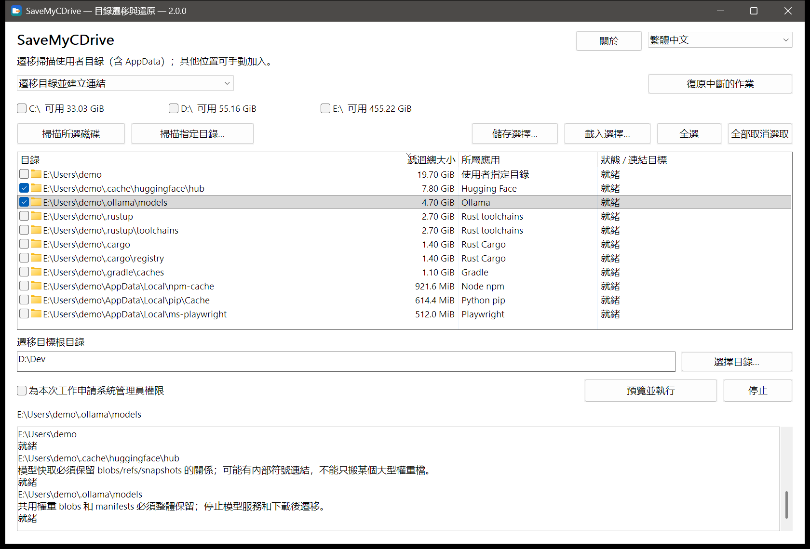

<div align="center">


# SaveMyCDrive · C盘救星

**你的 C 槽，不該替所有預設設定買單。**<br>
把資料搬走，把工作環境留下。<br>
**不刪資料 · 一鍵遷移 · 一鍵還原**

[](https://github.com/suifei/save-my-c-drive/releases/latest)
[](https://github.com/suifei/save-my-c-drive/actions/workflows/ci.yml)

[](#授權)

[English](README.md) · [简体中文](README.zh-CN.md) · **繁體中文** · [日本語](README.ja.md) · [한국어](README.ko.md) · [Deutsch](README.de.md)

</div>

SaveMyCDrive 把 `AppData`、使用者目錄裡那些越長越大的資料夾搬到其他磁碟，並在原位置留下目錄連結（junction）。軟體照舊按原路徑存取，資料實際存放在你選的地方；想搬回來，一鍵還原。

<p align="center"></p>

## 下載與使用

到 [Releases](https://github.com/suifei/save-my-c-drive/releases/latest) 下載 `SaveMyCDrive-v<版本>-windows-x64.zip`，解壓縮即可使用，免安裝，也不需要任何執行階段程式庫。

| 檔案 | 用途 |
| --- | --- |
| `SaveMyCDrive.exe` | 圖形介面 |
| `smcd.exe` | 命令列，與圖形介面共用同一核心和檢查 |

**圖形介面四步驟：**

1. **掃描**：勾選磁碟後按「掃描所選磁碟」，或「掃描指定目錄…」。掃描唯讀，不會改動任何東西。
2. **勾選**：清單每列是一個識別出的目錄，顯示大小、所屬應用程式和狀態；預設不勾選，灰色列表示目前不能遷移，選取一列可在下方記錄看到說明。
3. **選擇目的地**：填寫遷移目標根目錄（如 `D:\Dev`），按「預覽並執行」，逐項核對「原路徑 → 目標路徑」以及正在使用這些目錄的程式。
4. **需要時還原**：模式切換到還原連結，掃描連結所在的磁碟，勾選後還原。

**命令列範例：**

```powershell
smcd scan --volumes C: --mode migrate --measure --out scan.json
smcd plan --scan scan.json --select <id> --destination D:\Dev --out plan.json
smcd apply --plan plan.json
smcd restore --source C:\Users\You\.cache\huggingface
smcd history
```

`smcd --help` 列出全部命令；`--state PATH` 可把交易記錄放到指定目錄（可攜式使用）。

## 「我明明把軟體裝在 D 槽，怎麼 C 槽又滿了？」

安裝時特意選了 D 槽，專案放在別的磁碟，下載目錄也改了，C 槽還是紅了。

AI 工具又下載了一個模型，編輯器又裝了幾個擴充功能，編譯器累積了一輪快取，套件管理器又留了一份相依套件。它們藏在 `AppData`、藏在使用者目錄裡那些點開頭的資料夾，平時沒人會去看。直到系統更新失敗、編譯出錯、模型下載到最後提示空間不足。

**電腦有空間，軟體卻總往同一個地方塞。** 新手不敢亂動不認識的目錄；老手會寫 `mklink`，但找目錄、查占用、搬資料、記住每個目錄搬去了哪裡，仍得一遍遍手動來。SaveMyCDrive 把發現、預覽、遷移和還原放進同一個流程。

## 不刪，搬家：和其他做法比較

清理只能騰出一時的空間：刪掉的快取會長回來，下載過的模型還得再下載，而工作階段記錄、擴充功能這些資料根本不能刪。SaveMyCDrive 不刪任何資料，只幫它們換個磁碟存放。

| | 清理軟體<br>（CCleaner、儲存空間感知等） | 每次讓 AI 助理 / AI 技能來處理 | **SaveMyCDrive** |
| --- | --- | --- | --- |
| 做法 | 刪除快取和「垃圾」 | AI 現場查目錄、判斷、執行命令 | 整個目錄搬到其他磁碟，原路徑留目錄連結 |
| AI 程式設計工具的資料<br>（工作階段、模型、擴充功能） | 大多不認識，只能刪或不管 | AI 當場判斷，每次結論可能不同 | 124 條內建規則按路徑和應用程式標記識別 |
| 會不會遺失資料 | 刪除即消失，只能重新下載或產生 | 可能誤刪，把重要目錄當成快取 | 不刪；複製成功才清理原目錄，有殘留就停下 |
| 過一段時間 | 又長回來，要再清 | 又長回來，要再讓 AI 來一遍 | 新檔案直接寫到新磁碟，不再占用 C 槽 |
| 後悔了 | 找不回來 | 取決於 AI 當時執行了什麼 | 一鍵還原，連遷移後新增的內容一起搬回 |
| 中途斷電或中斷 | — | 執行到一半的命令難以追查 | 交易記錄，按記錄繼續或回復 |
| 每次的成本 | 免費，部分產品常駐背景、附帶推廣 | 每次消耗大量 token，結果不穩定 | 零 token，結果可重複；執行完即結束，不連網 |
| 能否審查 | 閉源 | 提示詞可讀，執行由模型臨場決定 | 開源，規則和流程都固定可查 |

### 為什麼不讓 AI 每次幫你清理？

AI 很擅長處理一次性、沒見過的問題，但「定期幫 C 槽騰空間」恰恰是重複的、攸關資料安全的事：

- **不穩定**：同一個目錄，這次 AI 說是快取可以刪，換個模型、換個問法，結論就可能不一樣。
- **會誤刪**：`.claude\projects` 看名字像快取，其實是 Claude Code 的工作階段記錄；`huggingface\hub` 裡的 blobs 和 snapshots 互相參照，只刪「最大的檔案」會讓模型損壞、幾十 GB 重新下載；一條路徑打錯的 `Remove-Item -Recurse` 或 `rm -rf`，就可能刪到上一層目錄。
- **浪費 token**：每次都要讓 AI 列目錄、算大小、查資料；過兩週 C 槽又滿，再付一次。
- **治標不治本**：刪掉的東西還會長回來。

SaveMyCDrive 把這些判斷固化成可審查的規則和固定流程：同樣的輸入得到同樣的結果，執行前可預覽，執行後可回復，不花一個 token。

## 它怎麼做

| | 軟體存取的路徑 | 資料實際存放的位置 |
| --- | --- | --- |
| 遷移前 | `C:\Users\You\.cache\huggingface` | C 槽 |
| 遷移後 | 原路徑不變，成為目錄連結 | `D:\Dev\huggingface` |

整個過程只用 Windows 內建的成熟工具：

1. **檢查**：列出正在使用該目錄的程式（按產品名稱歸類），請你先關閉；SaveMyCDrive 不會結束處理程序。
2. **複製**：系統 `robocopy` 多執行緒複製到目標磁碟旁的暫存目錄，以其傳回碼判斷成功。
3. **切換**：暫存目錄就位，原目錄內容由 `robocopy /MOVE` 收尾；來源目錄還剩任何檔案就停止並保留資料。
4. **連結**：系統 `mklink /J` 在原路徑建立目錄連結。

每一步寫入交易記錄。斷電或中斷後，「復原中斷的作業」依記錄和磁碟實際狀態繼續或回復，單一目錄與整批結果分別記錄。

## 關注那些總在悄悄長大的目錄

內建應用程式知識庫（124 條規則）按路徑和應用程式標記識別目錄，只有名稱相同不足以入選：

| 總在變大的內容 | 例子 |
| --- | --- |
| AI 工具與本機模型 | Claude Code、Codex、Kimi Code、Cursor、Hugging Face、Ollama、Torch、ModelScope |
| 編譯與建置資料 | Rust toolchains / Cargo、Go、vcpkg、C++ IntelliSense |
| 套件管理器快取 | npm、pip、uv、pnpm、NuGet、Gradle、Playwright |
| 編輯器與應用程式資料 | VS Code、Cursor、Obsidian 等 |

逐項清單見[應用程式目錄知識庫](docs/application-storage-list.md)（簡體中文）。標記為「需確認」的目錄會列出，但需要你先核對說明。

## 安全原則

- **掃描唯讀**，不會觸發遷移、還原、刪除或修復。
- **由你決定**：候選和所有可選開關預設不勾選；已有的目標內容不會被靜默合併或覆寫。
- **無法確認就停下**：複製失敗、占用未解除、身分變化、未知連結類型時保留資料並說明原因。
- **不跟隨連結刪除**：清理只用 `robocopy /MOVE` 和空目錄刪除，不做未經核驗的遞迴刪除。
- **還原搬回的是目前內容**，包括遷移後新增和修改的檔案；手動建立的連結也能發現和還原。
- **全在本機**：不收集遙測，不連網，不上傳檔案內容。

## 常見問題

**需要系統管理員權限嗎？**
整個磁碟的快速掃描（NTFS MFT）需要，SaveMyCDrive 會按需透過 UAC 請求，拒絕則改用一般掃描。遷移使用者目錄通常不需要。

**是不是所有軟體搬完都能用？**
保留原路徑是遷移方法，不是全軟體相容保證。更新程式、權限和目錄內容都會影響結果，已知限制會在清單和記錄中說明。

**支援哪些磁碟？**
本機 NTFS 磁碟區。網路路徑和其他檔案系統不在範圍內；目標磁碟須有足夠空間，遷移後使用相關軟體時須保持可存取。

## 介面語言

簡體中文是持續維護的介面語言。英文、繁體中文、日文、韓文和德文仍可使用，但新增文字不再翻譯；缺少的字串會改以英文顯示。

## 開發

需求、設計與驗證見 [docs/](docs/)（簡體中文）。以 Rust 實作，CLI 與原生 Win32 GUI 共用同一核心。

覺得有用，歡迎 **Star**，讓下一個 C 槽滿了的人更容易找到它。

## 聯絡方式

- QQ：410000
- 問題與建議：[GitHub Issues](https://github.com/suifei/save-my-c-drive/issues)

## 授權

可任選 [MIT](LICENSE-MIT) 或 [Apache-2.0](LICENSE-APACHE) 授權使用。相依套件的版權聲明隨發行套件附帶（`third-party-notices/`）。
