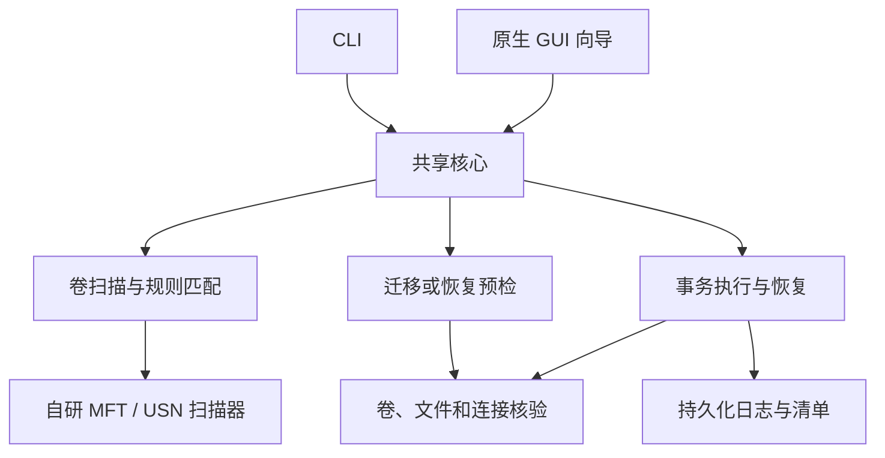

# FreePort 技术方案

版本：0.7（补充按需提权、目录树选择与执行范围归并）
日期：2026-10-24  
前置需求：[需求分析](requirements.md)  
状态：方案设计，未完成性能测试或数据安全验收。

2026-10-24 修订：[按需提权与目录树选择](elevation-and-selection.md)记录了现有代码缺口、原生树的级联/半选语义、共享选择模型、CLI 兼容表达、提权 worker 与专项验收。新增核心行为已接入 0.1.1-dev.1；实际 UAC 交互及全部原生数据安全验收尚未完成。本文涉及权限与父子目录选择的概述以该修订为准。

## 1. 关键决策

| 问题 | 建议方案 | 原因与边界 |
| --- | --- | --- |
| 开发语言 | Rust，Windows x64 优先 | 核心复用，使用 Win32 API 精确控制文件对象与重解析点 |
| CLI 与 GUI | 两个入口，共用一个核心库；GUI 采用原生 Win32 控件 | 无 WebView / Node 运行时，界面范围仅两个操作向导 |
| 多语言 | CLI / GUI 共用地区解析和离线消息资源；首批 `zh-CN`、`en`、`zh-TW`、`ja`、`ko`、`de` | 默认按 Windows 国家/地区映射，读取失败或未覆盖时英文；允许手动覆盖，机器协议不翻译 |
| 快速发现主路径 | 自研 Rust NTFS 扫描器，调用 Windows MFT / USN 接口 | 自己完成枚举、路径重建、快照与规则匹配；不依赖第三方搜索软件 |
| NTFS 枚举方式 | `FSCTL_ENUM_USN_DATA` 获取 MFT 名称线索，结合 USN 处理扫描期间变化 | 优先使用 Windows 支持的接口，不先解析原始磁盘 `$MFT` 字节布局 |
| 最后降级 | 受限 Win32 目录枚举 | 标明速度与覆盖限制；不把普通递归包装成“秒级全盘扫描” |
| 目录连接 | 新迁移使用 NTFS junction；恢复支持目录 junction 和目录 symlink | 区分符号链接、卷挂载点及其他重解析点 |
| 数据复制 | 首选原生 CopyFileExW / 文件流复制与元数据处理；以 Robocopy 为性能对照 | 能控制取消、进度、流、权限与逐文件事务；不把 `/MOVE` 当成事务 |
| 一致性 | 应用层预写日志、持久化校验、短暂路径切换、幂等恢复 | 跨卷不存在通用的原子“搬目录并建连接”系统调用 |
| 删除原则 | 仅清理本事务拥有且再次验证的对象 | 不对源目录或连接运行未经核验的递归删除 |
| 批处理 | 每目录独立提交，整批逐项记账 | 限制故障范围；明确不伪称多目录全局原子提交 |
| 高级特殊文件 | 能完整保留则支持；否则预检阻塞 | 安全降级为“不执行”，不能降级为“丢掉某项属性继续复制” |
| 释放占用 | 正常退出与强关句柄两个独立开关，均默认关闭 | 自研强关外部文件/目录句柄是首版必做；启用时警告，不依赖第三方解锁器 |

Windows 官方文档支持通过 `FSCTL_ENUM_USN_DATA` 枚举 MFT 记录线索；这与直接读取、解析磁盘上的原始 `$MFT` 是两条路线。第一版选择前者。[微软接口说明](https://learn.microsoft.com/en-us/windows/win32/api/winioctl/ni-winioctl-fsctl_enum_usn_data)

不采用 TxF 作为产品基础：微软建议使用替代方案，并说明其未来可用性存在限制。[微软 TxF 说明](https://learn.microsoft.com/en-us/windows/win32/fileio/transactional-ntfs-portal)

## 2. 核心结构

建议工程结构如下。属于实现规划，当前仓库不放置不可运行的框架冒充完成品。

| 模块 | 单一职责 |
| --- | --- |
| `scan` | 选卷、后端选择、分页和覆盖状态 |
| `rules` | 目录分类、保护规则、推荐理由、目标命名 |
| `links` | 重解析点识别、目标解析、链与循环检查 |
| `plan` | 路径关系、容量、占用、身份和能力预检 |
| `handles` | 自研句柄枚举、文件对象匹配、外部句柄关闭及结果复查；不调用解锁软件 |
| `transfer` | 复制、流和元数据处理、有界校验 |
| `transaction` | 状态机、预写日志、幂等动作、中断恢复 |
| `platform` | 最少范围的 Win32 / NT FFI，封装句柄、Restart Manager、系统句柄查询与错误 |
| `i18n`（规划） | 系统地区检测、语言选择、内置消息目录与带参数格式化；CLI / GUI 共用 |
| `cli` / `gui` | 参数或控件交互，不另行实现文件操作 |

依赖以 Win32 绑定、序列化和内容散列为主。第一版不引入数据库服务、Web 框架、Electron 或插件系统。依赖版本在实现时固定到锁文件，不依赖浮动的 `latest`。

### 2.1 共享语言选择与资源

语言范围、地区映射与选择优先级以[需求 6.1](requirements.md#61-首批多语言与自动适配)为准。本节是实现方案，尚未增加产品模块或翻译资源。

**地区检测。** 最低系统目标为 Windows 7。较新系统动态解析 `GetUserDefaultGeoName`；该入口不存在时，使用 Windows 7 可用的 `GetUserGeoID(GEOCLASS_NATION)` 与 `GetGeoInfoW(GEO_ISO2)` 读取同一用户的国家/地区设置。已存在的新 API 调用失败、旧接口失败、空值、未覆盖或数字地区代码均回退英文，不读取界面语言、IP 或时区来猜测。只按需求表的国家/地区代码映射。参考：[GetUserGeoID](https://learn.microsoft.com/en-us/windows/win32/api/winnls/nf-winnls-getusergeoid)、[GetGeoInfoW](https://learn.microsoft.com/en-us/windows/win32/api/winnls/nf-winnls-getgeoinfow)。

国家/地区与显示语言、区域格式是不同设置。本需求指定按国家/地区自动选择，因此不使用 `GetUserDefaultLocaleName`、系统 UI 语言或浏览器语言替代地区检测；检测失败仍执行英文回退。读取本机设置不需要联网定位，不申请管理员权限，也不改变 Windows 的设置。

共享解析器输出 `requested_language`、`effective_language` 和选择来源（本次参数、已保存偏好、系统地区、英文回退）。CLI `--lang` 仅覆盖本次，不落盘；GUI 保存 `auto` 或六种资源标识之一到用户级轻量设置，与 CLI 共用。显式 `auto` 跳过已保存的手动值。地区读取失败属于展示层降级，不阻塞只读扫描；非法 CLI 语言参数在计划和文件操作前用英文报错。GUI 语言选择在执行期间禁用，任务开始时冻结展示语言，不改变任务状态或安全开关。

**资源组织。** 规划 `locales/en.json`、`zh-CN.json`、`zh-TW.json`、`ja.json`、`ko.json`、`de.json`，按现有序列化能力读取并嵌入构建产物；不增加翻译 SDK、运行时下载或语言服务。六语共用稳定消息键和命名参数，例如 `migration.blocked_in_use`、`handles.force_close_warning`。完整句子作为词条，按语言处理数量表达；禁止拼接源语言短句后再翻译，也不将用户路径作为格式串。

英文消息目录为必备基线；其他语言缺词条时回退英文并给出可定位的消息键诊断。六语完整性与格式参数一致性是发布门槛，不以运行时回退代替补齐翻译。必要风险消息在当前语言缺失时须完整显示英文；连英文基线也不可用时，禁止相关写操作，不能用空白或消息键代替风险告知。

**核心与展示分离。** 核心事件包含稳定消息键、带类型参数、错误码和必要的 Win32 错误数字；CLI / GUI 在展示层渲染。路径、卷/文件身份、状态机、规则与事务标识不本地化，不能从翻译字符串解析状态。规则显示名称、分类、推荐理由和阻塞理由通过消息键关联，不以翻译后的名称匹配应用。现有实现已将展示文案放入六套资源；核心结构化消息事件仍需进一步统一，当前进度字符串不用于协议判断。

机器可读 JSON 的字段、枚举和数值保持跨语言稳定；可选 `message` 等人类说明可以本地化，脚本不得依赖其内容。命令与参数仍用固定拼写，确认提示翻译，输入令牌 `yes` 不变。事务日志保存事实、代码与参数；更换语言后仍按同一事实恢复，不依赖旧日志中的人类说明。Win32 原始错误文本若来自系统，可附原文，但须同时提供所选语言的摘要和数值错误码，不承诺替系统翻译任意返回文本。

**Unicode 与布局。** 沿用 Windows 宽字符接口与无损路径对象；控制台使用支持 Unicode 的输出方式，重定向/文件输出采用 UTF-8，不要求用户手动切换代码页。GUI 使用系统字体回退、按实际译文测量和 DPI 缩放，允许换行及调整控件；德语长标签、中日韩文本和完整风险说明不得被固定宽度截断。路径展示与执行用对象分离，不因翻译或显示编码转换改变实际文件名。

**验证与回退。** 先验证地区矩阵、六语资源键/参数和两端解析结果，再在专用隔离样本上检查全流程、提示语义、机器协议及事务恢复不随语言改变。GUI / CLI 六语共用同一批核心事件样本；原生窗口另做高 DPI、长文本和风险警告可读性检查。若本地化引发故障，本次语言可退回内置英文，不能通过省略确认或降低事务校验继续执行。对应验收为 A22–A25。

## 3. 任意盘与身份模型

### 3.1 卷发现

使用 Windows 卷枚举与挂载路径 API 获取卷 GUID、卷序列、挂载路径、文件系统、容量及在线状态。C、D、E 只是展示名称，不能作为唯一身份；一个卷存在多个挂载路径时不能重复计数。

允许用户选择任意本地卷，并检查该卷实际能力。外接 NTFS 盘不因盘符不同被拒绝，但断开、替换或盘符变化后必须重新验证。操作系统目录和真实卷挂载点由保护规则排除。

UNC 和映射网络盘不进入写事务。对主动发布的业务 SMB 共享路径，通过共享路径枚举与实际对象关系检查源/目标是否重叠，重叠则拒绝；不能只检查输入字符串有没有 `\\`。系统默认的 `C$`、`ADMIN$` 等管理共享不因名称存在而封锁整台机器，远程打开文件及无法确认的远程写入按占用与一致性规则阻塞。多处本地连接引用同一真实目录属于引用关系，不是 SMB 共享。

### 3.2 对象标识

| 信息 | 用途 |
| --- | --- |
| 卷 GUID + 卷序列 | 判断还是不是原卷，不能只比较盘符 |
| `FILE_ID_INFO` 等文件身份 | 检测相同路径已被替换、改名或连接到其他对象 |
| 父目录身份 + UTF-16 相对名 | 定位条目和检测父路径被替换 |
| reparse tag + 原始 reparse data | 精确识别连接；回退时恢复原连接对象语义 |
| 最终打开对象的卷和文件身份 | 阻止文字路径相同但真实对象不同的操作 |

索引结果不具备执行权限。所有实际写入都通过重新打开的对象核验，敏感操作尽量通过句柄完成；文本规范化和 `canonicalize` 不能独自解决 TOCTOU。路径按目录组件比较，不使用容易误判 `C:\foo` 与 `C:\foobar` 的裸字符串前缀。

UTF-16 名称必须无损保存，显示时可以转换，执行时不能用有损字符串回写。长路径、大小写敏感目录、设备路径及路径穿越在预检中统一处理。

## 4. 自研高性能扫描器

### 4.1 技术边界与权限

扫描器全部由本项目实现：直接读取 Windows 提供的 NTFS 名称元数据，自己构建父子关系、重建路径、匹配规则及发现连接。没有外部搜索 SDK、IPC、搜索客户端或索引服务。

| 条件 | 行为 |
| --- | --- |
| 本地 NTFS，已获得所选卷读取权限 | 使用 MFT / USN 批量元数据枚举 |
| 扫描时无卷读取权限 | 明确提示可提权；用户不提权时降级为普通只读枚举，不能宣称仍满足快速全盘目标 |
| journal 未启用、被删除或读不到 | 不自动创建或重建系统 journal；按该卷实际能力尝试只读枚举或降级，并标注结果一致性 |
| 非 NTFS | 用 Win32 只读目录枚举说明范围；写事务仍受文件系统支持范围限制 |

优先调用受支持的控制码，不自行解释裸磁盘上的 `$MFT` 物理布局。应用扫描器仍然是自主实现；Windows 文件系统驱动负责解释 NTFS 内部格式。

### 4.2 批量名称枚举与路径重建

1. 枚举卷 GUID 及挂载位置，以卷句柄定位扫描对象；只申请需要的访问权，不写原始卷、不修改 MFT。
2. 若 journal 可读，调用 `FSCTL_QUERY_USN_JOURNAL` 保存 journal ID、起点和边界。
3. 用 `FSCTL_ENUM_USN_DATA` 从起始文件引用号开始批量枚举，按返回游标继续；缓冲区初始采用 MiB 量级，实测后调整。
4. 按记录长度与版本解析 USN_RECORD，检查长度、对齐、名称偏移及缓冲区边界，拒绝损坏或未知格式，不使用未校验的 `unsafe` 强转遍历。
5. 保留文件引用号、父引用号、UTF-16 名称及属性。路径重建主要依赖目录项，避免为每个普通文件都分配完整绝对路径。
6. 建立目录父子映射并缓存已解析父路径；处理父项缺失、目录重命名、循环与记录号复用。无法解析项标为不完整。
7. 迁移模式优先匹配目录规则；恢复模式优先收集重解析点。候选路径一旦可确定就流式显示，不等待精确大小统计。
8. 普通文件仅保留当前扫描与候选聚合必要的数据；通过紧凑结构、分批处理和实际内存基准约束规模，不能让全盘名单无界占内存。

全卷名称枚举是线性元数据处理，不意味着恒定时间。最终耗时受 MFT 条目数、磁盘和权限影响，需与性能目标对应验证。

### 4.3 扫描期间变化与同次运行复用

- 全量枚举开始和结束记录 journal 边界，通过 `FSCTL_READ_USN_JOURNAL` 补读期间发生的创建、删除及重命名，更新内存名称快照。
- USN 返回父目录与文件引用号时按身份归并，不把同名新文件当作旧文件。硬链接变化不能只靠单条名称记录推导全部路径，需要对候选补充实际核验。
- journal ID 改变、区间被截断、版本不支持或补读失败时，不继续把旧快照标为完整，重扫或明确降级。
- 同次程序运行中，重复扫描可用连续 USN 增量刷新内存快照后重新匹配；关闭程序后不运行后台监控。
- 为保持第一版简单，不建立永久全盘搜索数据库，不提供通用文件搜索功能。
- 元数据快照只服务于发现；执行前必须读取实际对象身份和状态，不能把 USN 无变化当作内容校验替代。

### 4.4 大小统计、覆盖与精确核验

**USN_RECORD 的名称和属性字段不包含完整文件体积、ADS、ACL、硬链接关系或内容。** 精确大小与文件系统特殊信息要另取；不能用目录元数据长度冒充其全部内容大小。[USN_RECORD 结构](https://learn.microsoft.com/en-us/windows/win32/api/winioctl/ns-winioctl-usn_record_v2)

| 阶段 | 数据来源 | 是否读取内容 |
| --- | --- | --- |
| 首屏候选 | 自研 MFT / USN 名称映射与规则 | 否 |
| 展示大小 | 只针对命中候选，按需读取实际文件大小并聚合 | 通常只读元数据 |
| 连接详情 | 不跟随打开重解析点，读取 tag、原始数据与目标身份 | 否 |
| 执行预检 | 实际对象、流、权限、链接和容量 | 必要时读取 |
| 完整校验 | 每个数据流的内容散列、结构和元数据清单 | 是 |

显示“逻辑大小”“预计实际释放”“未知/统计中”的区别。稀疏、压缩和硬链接会让逻辑大小不等于占盘大小；无法准确估算时不得用精确数字误导用户。

目录无法访问、名称枚举不完整和精确统计失败应分别展示。不能因返回 0 项就认定整个卷没有候选，也不能凭本次扫描未发现其他连接便认定真实目标可以删除。

## 5. 连接发现与恢复定位

打开候选时使用 `FILE_FLAG_OPEN_REPARSE_POINT` 和目录所需标志，通过 `FSCTL_GET_REPARSE_POINT` 读取原始 tag 与数据，避免默认打开就跟随到目标。[微软重解析点操作](https://learn.microsoft.com/en-us/windows/win32/fileio/reparse-point-operations)

| 类型 | 发现与执行策略 |
| --- | --- |
| 普通目录 junction | 读取 substitute name 和 print name，核对真实目标 |
| 目录 symlink | 同时解析 relative 标志；相对目标必须基于连接所在父目录计算 |
| 文件 symlink | 可识别，第一版的目录恢复向导不执行文件恢复 |
| 真正的卷挂载点 | 与目录 junction 可能使用相同 mount-point tag，但语义不同；第一版排除 |
| 云占位符 / App execution alias / 未知 tag | 不当作普通连接处理 |
| 系统兼容 junction | 结合已知保护规则和系统属性识别，禁止普通恢复 |

解析每一跳保存 `(卷身份, 文件身份)`，设置有限跳数，发现循环或断链停止。展示“原始目标”和“最终真实目录”；执行前再次比较链和最终身份。不可把 `.lnk` 快捷方式或 NTFS 硬链接误当成目录软连接。

**恢复的发现入口是盘上的连接，事务日志只用于补充归属和处理中断。** 从外部连接开始恢复时，先记录本次连接原始数据和目标身份，再进入相同事务引擎。

## 6. 事务协议与一致性

### 6.1 基本原则

迁移不是 `robocopy /MOVE` 加 `rd`。正式协议分为“准备 → 复制 → 验证与持久化 → 路径切换 → 已验证清理”。跨卷真实内容必须先复制；同卷可用元数据重命名优化，但不能改变后续连接和恢复协议。

目录重命名只在单卷内完成。源目录改名和连接占据原路径是两个动作，其间存在短暂窗口；日志与回退负责处理中断，不能描述成一次原子操作。用户应用在整个操作期间应停止访问该目录。

### 6.2 目录、清单与日志布局

每项生成唯一 `transaction_id`。下面的名字是协议示例：

| 对象 | 位置 | 作用 |
| --- | --- | --- |
| 原目录或原连接 `S` | 用户原路径 | 操作前后的稳定访问路径 |
| 目标暂存 `T.stage` | 目标最终路径同卷、同父目录 | 存放已复制但未提交的内容 |
| 最终目标 `T` | 用户预览确认的路径 | 迁移后的真实目录 |
| 原内容保留目录 `S.hold` | 原路径同卷、同父目录 | 切换后仍保留的原始内容 |
| 恢复暂存 `R.stage` | 连接所在位置同卷、同父目录 | 复制真实目标当前内容 |
| 原连接保留条目 `L.hold` | 连接所在位置同父目录 | 恢复切换中保留原连接，便于回退 |
| 事务主日志 | 小型本机状态目录 | 重启后发现未完成事务 |
| 对象清单与事务标记 | 事务工作目录及必要的源侧小型标记 | 日志损坏或目标离线时定位现场；不进入用户正常数据树 |

日志采用带版本、事务 ID、递增序号、记录长度和校验值的预写记录。**不可逆动作前写 intent 并刷盘，动作后写完成记录并刷盘。** 清单记录相对路径、对象身份、数据流、散列、链接关系及所需元数据；不要把百万条清单反复序列化覆盖成一个巨大 JSON。

单写者锁防止两个实例操作同一现场；路径范围锁阻止父子目录事务并行。日志镜像不是分布式原子提交；恢复时必须结合各副本序号和磁盘真实对象裁决，不按某个状态字段盲目删除。

### 6.3 预检

迁移和恢复共用这些预检：

1. 重新核验卷和文件对象身份、权限、真实连接关系及路径包含关系。
2. 排除系统保护对象、本程序、正在使用的事务目录、父子重叠、多项目标冲突和危险嵌套。
3. 计算执行时的空间需求；恢复预留的是完整副本空间，不能假设删除连接能释放目标空间。
4. 根据实际文件系统能力检查 ADS、权限、稀疏、压缩、加密及链接语义是否可以保留。
5. 检查相关进程与占用，按用户的两个独立开关决定是否请求正常退出、是否执行自研强关句柄；默认只读识别。
6. 建立稳定读取和切换边界，目录仍在变化或无法阻止危险写入时拒绝提交。

进程名检查只是交互提示。共享模式、文件身份核验、变更检测及安全清理才是保护数据的必要机制；不能靠“没有查到进程”证明目录静止。

#### 6.3.1 两个默认关闭的占用处理开关

“请求占用程序正常退出”和“强制关闭外部文件/目录句柄”都是 GUI 独立开关，全部默认关闭，候选项也不默认勾选。新任务不自动恢复上次启用状态。两个都开启时先正常退出再强关；只开启强关也必须可用，不能要求先启用正常退出。

强关是用户明确要求的首版必做功能，不能以提示手动关闭或调用 Restart Manager 替代。启用时显示需求文档中的风险警告，用户接受后在本次选定范围内执行，不逐个句柄重复确认。CLI 的 `--request-app-exit` 和 `--force-close-handles` 对应同一核心逻辑，默认关闭；显式强关参数本身代表对本次范围的授权，仍须输出风险警告。

正常退出使用 Windows 自带的 `Rstrtmgr.dll`，Rust 可直接调用；强关句柄由本项目 Rust 模块直接使用 Windows / NT 接口实现，不启动 Unlocker、Handle、Process Explorer，不引入其 SDK、服务或驱动。正常退出集成成本预计低到中，强关的主要成本是对象匹配、竞态处理和兼容测试，不能因有风险而取消该必做功能。

“文件被使用”不代表所有 IO 都失败：能否读取、写入或重命名取决于现有句柄与新请求的访问权、共享模式，以及字节范围锁、内存映射等状态。普通占用检测、释放阻塞和数据静止校验必须分别处理。[CreateFile 访问与共享模式](https://learn.microsoft.com/en-us/windows/win32/api/fileapi/nf-fileapi-createfilew)

| 路线 | 工程代价与效果 | 决策 |
| --- | --- | --- |
| Restart Manager 识别占用，协商退出 | 系统自带 API；可识别部分占用并请求程序释放，存在权限和应用配合限制 | 独立开关，默认关闭 |
| 强制终止进程 | 代码不多，但未保存内容、数据库事务与服务状态可能损坏 | 不作为解锁失败的自动升级路径 |
| 自研强关外部文件/目录句柄 | 自行枚举、匹配、关闭并复查；可能影响外部应用状态，不能保证解除所有映射占用 | 首版必须实现；独立开关，默认关闭，启用时警告 |
| 内核驱动绕过占用 | 驱动签名、兼容及稳定性成本高，仍不保证数据一致 | 不做 |

微软的 Handle 文档说明强行关闭句柄可能导致应用或系统不稳定；这作为强关开关的风险提示依据，不作为取消功能的理由。该工具不成为本项目依赖。[Handle 官方说明](https://learn.microsoft.com/en-us/sysinternals/downloads/handle)

正常退出调用流程：

1. `RmStartSession` 建立会话，对实际发生阻塞的具体文件分组调用 `RmRegisterResources`；必要时注册已确认的进程身份，包含 PID 与创建时间以防 PID 复用。
2. 不把整个目录作为单一文件资源注册，也不对百万文件逐个注册。`RmGetList` 对目录资源可能报错；官方也指出资源注册较昂贵，应成组处理。
3. `RmGetList` 获取占用及系统重启原因。展示经核验的应用，排除系统关键进程、服务和其他用户会话，不按名称盲目结束所有同名程序。
4. 用户开启开关并确认影响范围后，才请求正常退出。可优先使用 `RmShutdownOnlyRegistered` 限制为支持重启的程序；**不设置 `RmForceShutdown`**。不支持的程序提示用户自行关闭。
5. `RmShutdown` 会重新查询资源使用者，因此优先注册已确认的 `RM_UNIQUE_PROCESS`，而不是用宽泛文件列表触发任意新占用者关闭；配合 `RmAddFilter` 排除不应关闭的对象。无法证明关闭范围受限时，只识别占用并提示手动退出，不调用关闭；实现时验证名单变化与过滤行为。
6. 退出完成后重新检查实际访问、内容变化和身份；仍有占用且本次已启用强关时进入下节流程，未启用则暂停相关项。不能因为正常退出失败就擅自打开强关。
7. 事务结束且原访问路径处于已验证的稳定状态后，对本次由系统关闭且可重启的应用遵循 `RmRestart` 生命周期；不自行拼接未知命令重启，不保证应用未保存会话可恢复。
8. `RmEndSession` 释放会话；取消和错误分支也要处理。应用被重新打开时有限重试，不能循环杀进程或承诺必定无中断。

正常退出与强关均完成后仍要重新执行事务预检。不能保证所有目录一定无中断：权限、保护进程、内存映射或持续写入仍可能阻塞；要报告具体原因，不能跳过数据校验来换取表面成功。

接口依据：[RmRegisterResources](https://learn.microsoft.com/en-us/windows/win32/api/restartmanager/nf-restartmanager-rmregisterresources)、[RmGetList](https://learn.microsoft.com/en-us/windows/win32/api/restartmanager/nf-restartmanager-rmgetlist)、[RmShutdown](https://learn.microsoft.com/en-us/windows/win32/api/restartmanager/nf-restartmanager-rmshutdown)、[RmAddFilter](https://learn.microsoft.com/en-us/windows/win32/api/restartmanager/nf-restartmanager-rmaddfilter)。

#### 6.3.2 自研强关外部文件/目录句柄

此模块实际实现外部句柄关闭，不只是占用查询或引导用户使用其他软件。使用用户态 Windows 原生接口；不注入目标进程、不修改其代码、不通过驱动绕过受保护进程。

| 子模块 | 实现方式与责任 |
| --- | --- |
| 系统句柄快照 | 动态绑定 `NtQuerySystemInformation`，适配 `SystemExtendedHandleInformation`；按返回大小有界扩容，验证架构、记录边界及实际版本 |
| 进程核验 | `OpenProcess` 申请查询与 `PROCESS_DUP_HANDLE` 等必要权限，核对 PID、创建时间、可执行文件和会话；不申请无必要的全权限 |
| 句柄复制与分类 | 先以不带关闭标志的 `DuplicateHandle` 取得本地副本；核验对象类型，只接受本地磁盘文件/目录，排除管道、设备、网络对象等 |
| 归属匹配 | 用最终路径、卷与文件身份以及已核验目录范围确定对象归属；仅匹配本次选中项，不能按进程名、文件名片段或裸路径前缀关闭 |
| 外部关闭 | 复查后调用带 `DUPLICATE_CLOSE_SOURCE` 的 `DuplicateHandle`，实际关闭目标进程内的匹配句柄，处理本地副本生命周期 |
| 结果复查 | 释放本模块的临时副本，重新枚举并实际测试所需访问能力；关闭失败或结果不确定不盲目重试旧编号 |

`SystemExtendedHandleInformation` 的内部结构不是稳定的跨版本 SDK 契约。仅在已支持且验证过的 Windows x64 构建上启用该适配；动态解析函数、验证布局、正确处理未知状态，不能为追求功能强行按错位内存关闭对象。结构资料可参考 [phnt 原始声明](https://github.com/winsiderss/phnt/blob/master/ntexapi.h)，模块逻辑由本项目实现，不将该项目的运行程序作为依赖。[微软 NtQuerySystemInformation 兼容性说明](https://learn.microsoft.com/en-us/windows/win32/api/winternl/nf-winternl-ntquerysysteminformation)

执行顺序：

1. 核验本次强关开关已显式开启、警告已展示，并固定本次选中的源与目标对象范围；默认流程绝不运行远程关闭动作。
2. 在迁移/恢复复制及校验基线建立前处理占用。若执行途中新增占用且允许重试，要先回到稳定的可恢复阶段，不能边删除源边强关不明对象。
3. 获取系统句柄快照，一次快照服务于本次范围；按进程分组，排除 FreePort 自身、其工作进程、系统关键进程和受保护对象。其他用户或更高完整性进程按实际权限报告，不隐式绕过系统保护。
4. 对有权限的候选进程复制句柄到自有查询上下文，确认是磁盘文件/目录。只解析必要的候选，并设置有界并发、内存和查询超时；可能阻塞的对象查询放入可回收的自有工作进程，不阻塞 GUI，也不终止目标应用。
5. 对本地副本获取最终对象路径和身份，确认在本次授权目录范围内。目录链接后的真实目标、硬链接及多路径别名按对象关系核验，不能因同名或别名而扩大范围；无法确定归属则报告并跳过该句柄。
6. 在调用前刷新候选句柄和进程身份，尽量缩短检查与动作间隔；发生对象变化、进程退出、PID/句柄复用或无法核验时，废弃候选并重新发现。
7. 刷盘记录 `HandleCloseIntent`：事务 ID、本次范围、PID 与创建时间、句柄值、文件身份及尝试序号；这是不可逆的外部副作用，不属于可回滚文件移动。
8. 用 `DuplicateHandle` 的 `DUPLICATE_CLOSE_SOURCE` 关闭目标进程的原句柄。采用显式接收本地副本的调用方式，返回后及时关闭本地副本及先前用于核验的副本，避免本工具自身继续占用文件。
9. 记录成功、失败或 `OutcomeUnknown`。该标志在返回错误时也可能已经关闭原句柄；错误不能解释成“未产生任何副作用”，不能直接拿旧编号再次关闭。[DuplicateHandle 官方语义](https://learn.microsoft.com/en-us/windows/win32/api/handleapi/nf-handleapi-duplicatehandle)
10. 重新枚举占用、核验文件身份、实际访问能力和内容变化，重新建立复制/校验基线。仍被映射、仍有占用或程序持续写入则有限重试，失败后保留现场；强关不能替代复制和校验。

**句柄复用竞态必须明示。** 普通用户态“检查远程句柄再关闭”不具有按预期对象原子比较并关闭的公开 API 保证；持有本地副本也不能保证远程句柄槽不会被复用。刷新快照、进程身份和对象核验只能收窄窗口，不能把它包装成零风险原子动作。强关开关启用时的外部应用风险包含这种竞态，验收须覆盖高频句柄复用，日志不能记录超出实际证据的成功结论。

**强关不等于解除内存映射或刷新应用缓冲。** 文件句柄关闭后，映射视图或已加载映像仍可能持有对象；不通过远程注入来卸载映射。应用随后仍可能访问已失效句柄、崩溃、重开文件或丢失尚未落盘的内容。这些影响不能由 FreePort 的文件事务恢复，风险提示必须明确，不能承诺“开启后仍绝对无损”。

中断恢复只依据文件事务恢复路径和内容，不自动重放旧的 `HandleCloseIntent`。旧 PID 和句柄值不具备重启后的身份保证；重新执行强关须作为新任务重新启用开关并显示警告。所有实际关闭行为均由本模块完成，第三方工具仅可用于开发时人工对照，不成为功能实现路径。

### 6.4 迁移步骤

| 阶段 | 行为 | 原数据保护条件 |
| --- | --- | --- |
| M0 Prepared | 持久化计划、身份和动作意图 | 尚未修改用户源 |
| M1 Copying | 创建本事务专属暂存；有界并发复制数据、流和受支持元数据 | 源目录仍完整；目标已有内容不合并 |
| M2 Verified | 目标数据及日志刷盘；逐流散列、结构和元数据核对；确认源未变化 | 校验未通过绝不清理源 |
| M3 Switching | 提交目标暂存为 `T`；源同卷改名为 `S.hold`；复核；预建连接同卷改名到 `S` | 原内容仍在 `S.hold`，动作前后均有落盘记录 |
| M4 Linked | 重新打开 `S`，核对连接类型与 `T` 文件身份，复核内容边界 | 原目录和目标都保留 |
| M5 Finalizing | 逐对象再次验证并清理 `S.hold` | 不删除新增、变更、替换或不明对象；不跨连接递归 |
| M6 Completed | 清理完成、路径和内容验证完成，持久化最终状态 | 可报告完整成功与实际释放量 |

源发生变化时可以在切换前重新复制与核验，但必须有限重试；持续写入直接终止。不能在未知新旧文件之间自动“取最新版”来合并。

切换后清理发现冲突，记录为 `NeedsAttention`，保留未清理副本和完整定位信息；不能把“连接可用但原目录未清理”冒充完整成功。

### 6.5 稳定边界与安全删除

这是实现的首要验证点，必须先在隔离数据集上验证，不能先接入真实目录：

- 文件读取与最终清理使用能检测冲突的共享模式和句柄，不允许活跃写入者在核验后悄悄改写待删除文件。
- 大目录不能无限持有所有句柄；采用有界批次。每个待删除文件通过其身份和内容与已持久化目标再次比对，并在保持保护句柄期间完成该对象删除。
- 保持并核对父目录身份，清理采用句柄或等价的抗替换操作，不能“按路径验证后再按路径删另一个对象”。
- 删除目录只删除确认身份的空目录。新增文件、后插入的重解析点、无法确认的内容会留下现场，不会被递归清掉。
- 已切换的目标同样不能在相关操作中被当作任意可写路径；目标身份和校验对象必须保持一致。
- 目录重命名、文件共享模式和原有应用句柄之间的实际交互必须有实验结果。若无法建立稳定切换和清理边界，该类目录保持阻塞，不降低安全标准。

这套协议保障可恢复文件系统操作，不为运行中数据库提供业务级一致性快照。SQLite 会话库、聊天数据等要求所属应用先完全退出；第一版不加入在线备份或 VSS 产品功能。

### 6.6 恢复步骤

| 阶段 | 行为 |
| --- | --- |
| R0 Prepared | 根据盘上实际连接建立新事务，记录原始 reparse data、连接与目标身份以及保留策略 |
| R1 Copying | 将真实目标的**当前内容**复制到连接旁的 `R.stage`，不修改原连接 |
| R2 Verified | 对暂存、真实目标、数据流和元数据完成校验与持久化，确认目标未变化 |
| R3 Switching | 原连接同卷改名到 `L.hold`，再将 `R.stage` 同卷改名为原连接路径 |
| R4 Materialized | 重新打开原路径，确认是普通真实目录且内容正确 |
| R5 Finalizing | 只删除已确认的旧连接条目；按预览策略保留外部/共享目标，或清理可证明由本事务独占的旧副本 |
| R6 Completed | 记录恢复完成及保留目标位置 |

移除 `L.hold` 只能移除连接本身，不能跟随连接清理目标。不能先删除真实目标再尝试恢复内容。即使没有历史记录，也能执行 R0 至 R6。

无法证明独占时，真实目标必须保留。其他连接、应用直接路径、离线卷和索引排除范围可能无法完整枚举，不能以“本次只看到一个连接”为删除依据。

### 6.7 中断恢复裁决

启动后先检查未完成事务。扫描可以继续只读进行，但冲突路径不能执行新写事务。中断现场与正常的“从盘恢复连接”是两个概念。

| 现场 | 继续或回退条件 |
| --- | --- |
| 源完整，仅有部分目标暂存 | 可重核源后继续复制；或只清理已确认属于本事务的暂存，源不动 |
| 目标已验证，源尚未改名 | 复核对象和变更后继续切换；不能只信日志中的 Verified |
| 源在 `S.hold`，原路径缺失 | 可按记录恢复原名，或在重新核验目标后完成连接；原路径被其他对象占据则停止 |
| 原路径已连接，保留目录还在 | 复核连接和两侧内容，继续安全清理；发现差异保留双方，不自动覆盖 |
| 恢复暂存完整，原连接仍在 | 重核真实目标后继续，目标变化则重新复制或停止 |
| 原连接在 `L.hold`，原位置缺失 | 将已验证暂存提交到原位置；不满足条件时恢复原连接 |
| 真实目录已恢复，旧连接还在 | 核验身份后只清理旧连接，不复制旧快照覆盖新目录 |
| 日志截断、校验失败、现场身份不符 | 读取可验证的最后记录并保留现场；无法证明归属时不自动删除 |
| 目标离线或卷被替换 | 等待正确卷重新出现，不按相同盘符操作其他卷 |

继续与回退都必须幂等：在任一步再次断电或重复执行，不能重复删除或覆盖。不可恢复的动作不能因记录丢失而被猜测成“已经完成”。

## 7. 文件系统语义

| 对象 | 实现与预检要求 |
| --- | --- |
| 普通数据及空目录 | 核对文件、目录全集；不是只比总文件数和总字节数 |
| ADS | 枚举数据流，复制并逐流散列；不只验证默认流 |
| 属性与时间 | 保留受支持属性、创建/修改时间和只读状态；访问时间等动态字段须明确比较规则 |
| ACL / owner | 保留所需安全描述符并验证；缺权限或目标语义改变时阻塞，不静默继承成更宽权限 |
| 内部硬链接 | 按卷与文件身份分组，在目标卷内部重建组内硬链接并验证关系 |
| 连接到目录外的硬链接 | 第一版默认阻塞；跨卷无法保留原有共享文件身份，不能悄悄复制成独立文件 |
| 内部相对 symlink | 不跟随展开；验证迁移后解析关系仍正确，创建权限不足则阻塞 |
| 外部相对 symlink | 换位置可能改变目标；第一版默认阻塞，不能靠文本照抄冒充保留语义 |
| 嵌套 junction / 绝对 symlink | 不递归跨越；只有能证明保留语义并通过专项测试才开放 |
| 稀疏或压缩文件 | 保留受支持布局属性并正确估算空间；不支持时预检拒绝，不能让目标意外膨胀至满盘 |
| EFS、离线占位、云同步特殊对象 | 第一版默认阻塞；不透明解密、不触发隐式大规模下载 |
| 未知 reparse tag | 保留并阻塞，不按普通文件处理 |

硬链接只能指向同卷文件，不能作为跨盘目录迁移手段；junction 可以指向其他本地卷上的目录。[微软链接说明](https://learn.microsoft.com/en-us/windows/win32/fileio/hard-links-and-junctions)

模型缓存常有 symlink 结构；迁移支持与验证必须覆盖此情形，不能简单使用“跳过全部链接”后仍宣称模型完整。[Hugging Face 缓存机制](https://huggingface.co/docs/huggingface_hub/guides/manage-cache)

## 8. 性能实现与测量

### 8.1 可以利用 NTFS 加速的部分

| 部分 | 优化 |
| --- | --- |
| 候选发现 | 自研 MFT / USN 批量名称枚举，避免逐层打开全部目录 |
| 路径组织 | 文件引用号与父关系重建；同卷操作使用重命名 |
| 同卷迁移 | 在保护、身份核验与事务要求满足时，直接改名到最终位置，再建立连接；不复制真实字节 |
| 文件清单处理 | 分页与紧凑结构，候选匹配后再读取昂贵属性 |
| 大文件 | 流式复制、连续读取、复用缓冲区；复制时可同步计算源散列，目标必须独立读取验证 |
| 大量小文件 | 每卷有界任务队列、适量并发；根据设备测量，不默认开几百线程 |
| 内容散列 | 有界并行；使用明确的安全散列，先以 SHA-256 为基准，再测量替代方案 |
| 持久化 | 数据流与关键事务边界刷盘，不每个小块都刷盘 |

同卷重命名优化必须单独形成事务分支：保存原对象身份、记录新位置、建立原路径连接；恢复同理。目标被共享或不属于本事务时，仍采用复制恢复，不能移动外部真实目标。

不能通过 NTFS MFT 将跨卷内容瞬间搬走，也不能用硬链接代替跨卷复制。块克隆只有在文件系统与卷关系满足条件时才可用，不作为通用 C → D 方案。

`FlushFileBuffers` 用于关键持久化边界，且必须检查返回值；频繁按小块调用会降低吞吐。持久化协议要通过真实重启测试验证，而不是仅凭 API 调用成功宣称抗断电。[微软刷盘说明](https://learn.microsoft.com/en-us/windows/win32/api/fileapi/nf-fileapi-flushfilebuffers)

### 8.2 基准测试

| 数据集 | 测量项 |
| --- | --- |
| 100 万与 500 万条名称记录 | 冷/热候选首屏、最终清单时间、峰值内存、权限、索引覆盖 |
| 10 万个小文件及空目录 | 枚举、复制、验证、切换、清理分别计时；峰值句柄数 |
| 20 GiB 大文件与真实模型样本 | 复制吞吐、独立目标校验时间、总耗时 |
| 混合缓存 | 只读文件、ADS、长路径、ACL、稀疏、内部链接与硬链接 |
| 同卷移动 | 文件身份是否保留，是否没有真实内容复制，恢复是否对称 |

基准报告固定硬件、磁盘、文件系统、加密/压缩状态、防病毒条件、数据集、索引状态、运行权限和样本次数，报告 P50 / P95。只公布实际结果，不以首屏发现时间代替全部迁移耗时。

## 9. 发布前验证门槛

| 顺序 | 工作 | 完成证据 |
| --- | --- | --- |
| P0 | 自研只读扫描验证 | NTFS 快速枚举与 Win32 降级能在任意选卷返回候选和连接；权限、覆盖、错误、性能有报告 |
| P1 | 事务机制验证 | 两个测试 NTFS 卷 / VHDX；稳定边界、身份核验、持久化、幂等与安全删除可证明 |
| P2 | 特殊对象验证 | ADS、ACL、只读、长路径、模型链接、硬链接等保留或阻塞符合方案 |
| P2a | 正常退出开关验证 | 默认关闭；只请求已确认应用正常退出；部分失败、重新打开及恢复生命周期符合约定 |
| P2b | 自研强关句柄验证（首版必做） | GUI 默认关闭及风险警告；实际关闭测试进程的匹配文件/目录句柄；覆盖权限、范围、复用、映射、结果不确定及不中断 GUI |
| P2c | 共享语言解析与六语资源验证 | A22–A25；地区失败回英文、手选覆盖、资源与参数完整、安全警告语义一致，机器协议与恢复裁决不变 |
| P3 | CLI 串通 | 迁移、从盘恢复外部连接、中断继续与回退共用核心，六语帮助、错误、确认及进度完整 |
| P4 | 最小 GUI | 只包装同一核心的迁移/恢复向导，状态、取消与结果准确；六语布局、手选与自动适配符合方案 |
| P5 | 本机样本与发布准备 | 先可再生缓存，再经确认的小规模真实目录；Git 身份、隐私与文档检查 |

故障注入覆盖每个 intent、文件创建、流复制、刷盘、重命名、连接创建、清理和外部句柄关闭动作的前后。注入方式包括返回错误、强制杀本工具测试进程、目标盘满、断开测试卷、并发写入、连接替换与 VM 断电。句柄专项使用专用测试子进程制造排他访问、目录占用、映射、PID/句柄复用和立即重开，不强关本机真实应用做验收。只通过正常路径测试不能开放真实迁移。

**当前决定：先评审这份方案，不编译发布程序，不执行本机真实迁移。** 稳定边界、特殊文件语义和抗断电恢复是实现前必须实测的技术门槛，不作为已完成能力对外宣传。

## 10. Git 与发布身份

- 本地仓库主分支使用 `main`。实现、规格和测试可提交；本机扫描结果、日志和构建产物不得提交。
- 已核验的项目所有者账号：GitHub `suifei`（ID `7343085`，显示名 `flynn`）。
- 仓库级提交身份使用 `flynn <7343085+suifei@users.noreply.github.com>`，author 与 committer 一致；不覆盖全局 Git 设置。
- 提交与推送前本地钩子检查身份和署名尾注；钩子使用 Python 3，仅为开发工具，新克隆运行 `python .githooks/setup.py` 安装后验证执行。机器路径不进入版本库，本地钩子不能冒充 GitHub 服务器的强制策略。
- 不添加协作作者或生成工具署名；不提交真实扫描报告、用户文件、日志、令牌和构建产物。
- 已收到后续开发和发布指令；推送前仍须通过 owner 身份与隐私检查。当前环境提交及联网限制见实现状态。项目许可证由所有者选择。

GitHub 通过关联邮箱识别提交归属，可以使用账号的 noreply 地址避免公开个人邮箱。[GitHub 邮箱说明](https://docs.github.com/en/account-and-profile/reference/email-addresses-reference)

## 11. 技术依据

以下来源用于确认接口能力和边界；架构、协议和验收目标为本项目设计，仍需实现与验证。

1. [FSCTL_ENUM_USN_DATA](https://learn.microsoft.com/en-us/windows/win32/api/winioctl/ni-winioctl-fsctl_enum_usn_data)
2. [USN_RECORD_V2](https://learn.microsoft.com/en-us/windows/win32/api/winioctl/ns-winioctl-usn_record_v2)
3. [Reparse Point Operations](https://learn.microsoft.com/en-us/windows/win32/fileio/reparse-point-operations)
4. [Hard Links and Junctions](https://learn.microsoft.com/en-us/windows/win32/fileio/hard-links-and-junctions)
5. [CopyFileExW](https://learn.microsoft.com/en-us/windows/win32/api/winbase/nf-winbase-copyfileexw)
6. [FlushFileBuffers](https://learn.microsoft.com/en-us/windows/win32/api/fileapi/nf-fileapi-flushfilebuffers)
7. [Transactional NTFS 的替代建议](https://learn.microsoft.com/en-us/windows/win32/fileio/transactional-ntfs-portal)
8. [Hugging Face 缓存机制](https://huggingface.co/docs/huggingface_hub/guides/manage-cache)
9. [GitHub 提交邮箱](https://docs.github.com/en/account-and-profile/reference/email-addresses-reference)
10. [CreateFile 访问与共享模式](https://learn.microsoft.com/en-us/windows/win32/api/fileapi/nf-fileapi-createfilew)
11. [RmRegisterResources](https://learn.microsoft.com/en-us/windows/win32/api/restartmanager/nf-restartmanager-rmregisterresources)
12. [RmGetList](https://learn.microsoft.com/en-us/windows/win32/api/restartmanager/nf-restartmanager-rmgetlist)
13. [RmShutdown](https://learn.microsoft.com/en-us/windows/win32/api/restartmanager/nf-restartmanager-rmshutdown)
14. [Handle 句柄关闭风险](https://learn.microsoft.com/en-us/sysinternals/downloads/handle)
15. [NetShareEnum](https://learn.microsoft.com/en-us/windows/win32/api/lmshare/nf-lmshare-netshareenum)
16. [RmAddFilter](https://learn.microsoft.com/en-us/windows/win32/api/restartmanager/nf-restartmanager-rmaddfilter)
17. [DuplicateHandle 与 DUPLICATE_CLOSE_SOURCE](https://learn.microsoft.com/en-us/windows/win32/api/handleapi/nf-handleapi-duplicatehandle)
18. [NtQuerySystemInformation](https://learn.microsoft.com/en-us/windows/win32/api/winternl/nf-winternl-ntquerysysteminformation)
19. [Process Security and Access Rights](https://learn.microsoft.com/en-us/windows/win32/procthread/process-security-and-access-rights)
20. [GetFinalPathNameByHandleW](https://learn.microsoft.com/en-us/windows/win32/api/fileapi/nf-fileapi-getfinalpathnamebyhandlew)
21. [phnt 的 NT 系统信息结构声明](https://github.com/winsiderss/phnt/blob/master/ntexapi.h)
22. [GetUserDefaultGeoName](https://learn.microsoft.com/en-us/windows/win32/api/winnls/nf-winnls-getuserdefaultgeoname)

## 12. Windows 兼容与规则包实现约束

最低目标为 Windows 7 SP1 x64，GUI 使用 Win32 控件而非 WebView、Electron 或 Qt；产品不要求第三方运行时 DLL。当前编译产物采用 `x86_64-win7-windows-gnu` 与自行构建的匹配标准库、静态 CRT；`CopyFileExW` 提供复制进度和取消。较新系统 API 必须动态解析并提供保守回退；关键进程检测在旧系统用动态 `NtQueryInformationProcess(ProcessBreakOnTermination)`，查询失败则排除该进程，不以猜测代替检测。体积与导入检查只能作为构建门槛，Windows 7、后续 Windows、高 DPI 和特殊对象必须实测。当前 x86/ARM 没有交付构建，不将尚未验证的平台写成支持。

可扩展规则独立放在 `rules/freeport-rules.json`，包含 `schema_version`、单调递增 `revision` 和数据规则。规则导入限制包大小、数量、ID、后缀组件、进程名和未知字段，持锁并原子替换；核心的保护目录、重解析点/身份检查、默认选中状态和句柄授权不受规则控制。首版仅离线导入，不新增后台服务或自动联网。六语资源随程序离线打包，与数据规则更新分开。

具体已实现行为、差异和未通过测试见 [实现状态](implementation-status.md)；构建及故障验收命令见 [开发说明](development.md)。

参考：[Rust Win7 target](https://doc.rust-lang.org/rustc/platform-support/win7-windows-gnu.html)、[NtQueryInformationProcess](https://learn.microsoft.com/en-us/windows/win32/api/winternl/nf-winternl-ntqueryinformationprocess)。
