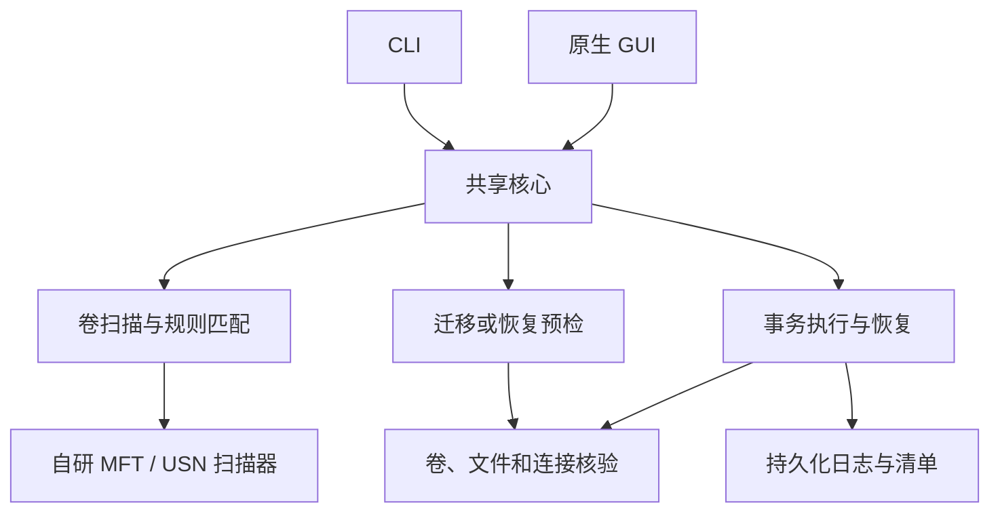

# FreePort 技术方案

版本：1.0（对应[需求 1.0](requirements.md)）
范围：核心迁移/恢复。搬运命令与参数见[系统命令后端](system-command-backend.md)；当前实现与验证状态见[实现状态](implementation-status.md)；构建与测试见[开发说明](development.md)。

## 1. 关键决策

| 问题 | 方案 | 原因与边界 |
| --- | --- | --- |
| 语言 | Rust，Windows x64；最低目标 Windows 7 SP1 | 使用 Win32 API 精确控制文件对象与重解析点 |
| 入口 | CLI `fp` 与原生 Win32 GUI 共用一个核心库 | 无 WebView / Node 运行时；GUI 只有迁移与恢复两个入口 |
| 发现 | 自研 NTFS 扫描器，调用 `FSCTL_ENUM_USN_DATA`（MFT / USN） | 不依赖第三方搜索软件；不解析裸盘 `$MFT`；不可用时回退 Win32 只读遍历并说明原因 |
| 复制与连接 | 系统 `robocopy` 与 `cmd /c mklink /J` | 不自写复制器；FreePort 提供预检、校验、日志与恢复 |
| 一致性 | 预写日志、持久化校验、短暂路径切换、幂等恢复 | 跨卷没有原子的“搬目录并建连接”系统调用，不宣称原子 |
| 删除 | 只清理本事务拥有且再次验证的对象 | 不对源目录或连接做未经核验的递归删除 |
| 批处理 | 每目录独立事务，整批逐项记账 | 部分完成不报告为整批成功 |
| 特殊对象 | 能完整保留则支持，否则预检阻塞 | 不能降级为“丢弃某项属性后继续” |
| 占用 | 只检测并展示，由用户关闭程序 | 强关句柄与请求退出见第 9 节 |
| 提权 | 沿用按需 UAC，不再扩展 | 见第 6 节 |
| 多语言 | 已有六语资源冻结，不维护 | 新增文案只需简体中文，缺词条回退；命令名、参数、JSON 字段、退出码、事务 ID 不翻译 |

不采用 TxF（微软建议使用替代方案）。[说明](https://learn.microsoft.com/en-us/windows/win32/fileio/transactional-ntfs-portal)

## 2. 核心结构



| 模块 | 职责 |
| --- | --- |
| `scan` | 选卷、后端选择（MFT / Win32）、覆盖状态 |
| `rules`、`catalog` | schema v2 知识库、应用证据门槛、候选生成 |
| `inventory` | 候选行、大小与链接计量 |
| `selection` | 共享的目录选择模型与计划归并 |
| `engine` | 预检、事务状态机、预写日志、校验、恢复 |
| `system_ops` | robocopy / cmd 适配器 |
| `batch` | 批次台账，只记进度，不是原子事务 |
| `elevation` | 一次性 UAC worker |
| `platform` | 最少范围的 Win32 / NT FFI |
| `handles` | 外部句柄代码，保留但不接入发布流程（第 9 节） |
| `i18n` | 冻结的六语资源 |
| `cli`、`gui`、`folder_tree`、`native_dialog` | 参数与原生界面，不另行实现文件操作 |

依赖以 Win32 绑定、序列化和内容散列为主；不引入数据库服务、Web 框架或插件系统，版本固定在锁文件。

## 3. 卷与对象身份

- 通过 Windows 卷枚举获取卷 GUID、卷序列、挂载路径、文件系统、容量与在线状态。盘符只是展示名；盘符相同不代表同一盘，拔插或换盘后必须重新核验。
- 本地 NTFS 卷之间可迁移；操作系统目录和真实卷挂载点由保护规则排除。UNC、映射网络盘不进入写事务；业务 SMB 共享通过共享路径枚举与实际对象关系检查重叠，重叠则拒绝。多个本地连接引用同一真实目录是引用关系，不是 SMB 共享。

| 信息 | 用途 |
| --- | --- |
| 卷 GUID + 卷序列 | 判断是否仍是原卷 |
| `FILE_ID_INFO` 等文件身份 | 检测同路径被替换、改名或连到其他对象 |
| 父目录身份 + UTF-16 相对名 | 定位条目，检测父路径被替换 |
| reparse tag + 原始 reparse data | 精确识别连接；回退时保持连接语义 |

索引结果不具备执行权限：写入前重新打开实际对象核验，敏感操作通过句柄完成。路径按目录组件比较（不能让 `C:\foo` 匹配 `C:\foobar`），UTF-16 名称无损保存，长路径、大小写敏感目录、设备路径与路径穿越在预检中统一处理。

## 4. 扫描器

全部由本项目实现：直接读取 Windows 提供的 NTFS 名称元数据，自行构建父子关系、重建路径、匹配规则、发现连接；无外部搜索 SDK、IPC、客户端或索引服务。

| 条件 | 行为 |
| --- | --- |
| 本地 NTFS，具备所选卷读取权限 | MFT / USN 批量枚举 |
| 无卷读取权限 | 提示可授权；用户不授权则回退普通只读遍历，不宣称仍满足快速目标 |
| USN journal 未启用或读不到 | 不创建或重建系统 journal；只读枚举或降级，标注一致性 |
| 非 NTFS | Win32 只读枚举并说明范围；写事务仍受文件系统限制 |

流程：`FSCTL_QUERY_USN_JOURNAL` 记录边界 → `FSCTL_ENUM_USN_DATA` 批量枚举 → 按长度、对齐、名称偏移校验解析 USN_RECORD（拒绝损坏或未知格式）→ 重建目录父子映射，处理父项缺失、循环与记录号复用，无法解析的标为不完整 → 迁移模式匹配规则，恢复模式收集重解析点。期间变化用 `FSCTL_READ_USN_JOURNAL` 补读；journal ID 变化、区间被截断或补读失败时不把旧快照标为完整。同次运行内可用 USN 增量刷新，不运行后台监控，不建永久搜索库。

扫描范围为用户目录及其中的 AppData：选盘后识别当前/注册用户配置目录和带 NTUSER.DAT 的 Users 子目录；Win32 回退只遍历这些目录，MFT 读取卷级索引后按范围过滤。其他位置可手动添加，恢复仍按所选盘找连接。规则与证据门槛见[应用存储调研](application-storage-research.md)。

USN 记录不含文件体积、ADS、ACL、硬链接关系或内容。大小只对命中候选按需读取，区分“逻辑大小”“预计释放”“统计中/未知”；目录不可访问、枚举不完整、统计失败分别展示，不把 0 项当作没有候选。元数据快照只服务于发现，不替代执行前的实际核验。

## 5. 连接发现

用 `FILE_FLAG_OPEN_REPARSE_POINT` 打开，`FSCTL_GET_REPARSE_POINT` 读取原始 tag 与数据，避免跟随到目标。

| 类型 | 策略 |
| --- | --- |
| 目录 junction | 读 substitute / print name，核对真实目标 |
| 目录 symlink | 解析 relative 标志，相对目标基于连接所在父目录计算 |
| 文件 symlink | 可识别，不执行恢复 |
| 卷挂载点 | 与 junction 可能同 tag 但语义不同，排除 |
| 云占位符、App execution alias、未知 tag | 不当作普通连接 |
| 系统兼容 junction | 结合保护规则识别，禁止恢复 |

逐跳记录 `(卷身份, 文件身份)`，限制跳数，遇循环或断链停止；展示原始目标与最终真实目录，执行前再次比较。`.lnk` 与硬链接不是目录连接。恢复的入口是盘上实际连接，事务日志只补充归属与处理中断。

## 6. 目录树选择与提权

### 6.1 选择模型

选择模型在核心（`selection`），GUI 的 `SysTreeView32` 只负责显示与输入。默认所有节点不勾选；候选根默认折叠，展开时惰性加载子目录，惰性节点继承选择意图。

- 候选根是**规则已识别且允许整体迁移的最外层目录**，不能扩大为整个 AppData、用户主目录或磁盘。导航节点（磁盘、Users、AppData）只组织路径，自身不生成任务。
- 勾选目录 A：A 全选、子孙继承，只生成 A 一项事务。A、A/B、A/B/C 同时传入归并为 A，与顺序无关，重复项在预览中列出。
- 只勾选 A/B：只迁 A/B，不自动扩成 A。全选 A 后取消 A/B：A 半选，A 自身不迁移，只迁其余完整选中的子目录；父目录直属文件留在原处，预览逐项列出，不暗示支持“父目录整体迁移但留一个例外”。
- 已含内部连接的父目录不能整体迁移，显示连接并阻塞；可改选其他无链接的独立兄弟分支。要迁整个父目录，须先恢复内部连接并重新扫描。
- 阻塞或未知节点显示原因，祖先勾选不能越过阻塞。恢复树按连接的逻辑路径组织，多个连接指向同一目标仍是不同恢复项。
- 生成的计划必须去重、归并幂等、输入顺序无关，且源-源、目标-目标、源-目标均不重叠；体积不重复累加。引擎的重叠与 reparse 检查是最后防线。

CLI 简单选择用 `--select id1,id2`；复杂树选择用 `--selection selection.json`（二者互斥），GUI 保存的选择文件可直接交给 CLI：

```json
{
  "version": 1,
  "include": ["C:\\Users\\Example\\AppData\\Local\\npm-cache"],
  "exclude": ["C:\\Users\\Example\\AppData\\Local\\npm-cache\\_npx"]
}
```

路径为绝对逻辑路径，必须位于扫描候选根内；加载时重新检查实际目录，拒绝别名逃逸、未知字段、矛盾输入与超限，最具体的包含/排除生效。文件不携带可信快照身份，执行前仍重新预检。

### 6.2 按需提权

程序以普通权限启动。仅在 MFT 快扫需要卷读取、或写操作缺权限时，用 `ShellExecuteExW` 的 `runas` 启动同一 EXE 的一次性 worker；不整体声明 `requireAdministrator`。

- 快扫缺权限时询问“授权快速扫描 / 继续普通扫描 / 取消”。迁移、恢复、事务恢复在首次改动用户数据前做能力预检。
- 拒绝授权：快扫回退普通遍历；写操作停止且不改动数据；界面状态、选择、目标不丢失，同一任务不循环询问。已提权仍失败时显示实际错误，不改 ACL、不接管所有权。复制中途才发现权限问题，按事务协议安全停止，不提权后盲目重跑。
- CLI `--elevate` 仅显式允许必要时申请 UAC，默认关闭；脚本默认不弹 UAC，缺权限时返回稳定错误。
- worker 约束：只接受受支持操作与有限大小的结构化请求；本地 ACL 命名管道，绑定父子进程 PID、创建时间与映像身份，限制报文长度，拒绝重放；提权后重新核验卷、对象、连接、选择范围与事务状态；传递发起用户的上下文（源路径、状态目录、规则快照），不使用管理员账号自己的 USERPROFILE；一个 worker 只服务当前操作，不保存凭据，无常驻服务或驱动。
- 扫描回退原因、实际后端与覆盖情况即时展示；错误 5、1314 等保留数值，不把所有失败归因于缺少管理员权限。

## 7. 事务协议

### 7.1 原则与布局

迁移按用户批处理的语义：创建暂存 → robocopy 复制 → 校验与持久化 → 提交目标并保留源 → robocopy `/MOVE` 收尾 → 只移除空源目录 → `mklink /J`。参数见[后端协议](system-command-backend.md)。目录重命名只在单卷内完成；源改名与连接占据原路径是两个动作，其间有短暂窗口，由日志与回退处理。同卷迁移当前同样走复制协议。

每项生成唯一 `transaction_id`：

| 对象 | 位置 | 作用 |
| --- | --- | --- |
| `S` | 原路径 | 操作前后的访问路径 |
| `T.stage` / `T` | 目标同卷同父目录 | 已复制未提交的内容 / 最终目标 |
| `S.hold` | 原路径同卷同父目录 | 切换后保留的原内容 |
| `R.stage` / `L.hold` | 连接旁 | 恢复暂存 / 保留的原连接 |
| 事务日志与清单 | 本机状态目录 | 重启后发现未完成事务，定位现场 |

日志是带版本、事务 ID、递增序号、长度与校验值的预写记录：**不可逆动作前写 intent 并刷盘，动作后写完成记录并刷盘。**清单记录相对路径、对象身份、数据流、散列、链接关系与元数据。单写者锁防止多实例操作同一现场，路径范围锁阻止父子事务并行。恢复时结合日志序号与磁盘真实对象裁决，不按状态字段盲目删除。

### 7.2 预检

迁移与恢复共用：

1. 重新核验卷与文件对象身份、权限、连接关系、路径包含关系。
2. 排除受保护位置、本程序、事务目录、父子重叠、目标冲突、危险嵌套。
3. 计算空间；恢复需要完整副本空间，不假设删连接能释放目标空间。
4. 按实际文件系统能力检查 ADS、稀疏、压缩、加密、链接语义能否保留。
5. 检测占用并展示进程与原因（只读识别）；占用未解除则停止。
6. 建立稳定读取与切换边界，目录仍在变化或无法阻止危险写入时拒绝提交。

进程名检查只是提示；共享模式、身份核验、变更检测才是保护数据的机制，“没查到进程”不证明目录静止。

### 7.3 迁移阶段

| 阶段 | 行为 | 原数据保护 |
| --- | --- | --- |
| M0 Prepared | 持久化计划、身份与动作意图 | 源未改动 |
| M1 Copying | 创建专属暂存，robocopy `/E /COPY:DAT` | 源完整；目标已有内容不合并 |
| M2 Verified | 刷盘；逐流 SHA-256、结构、元数据核对；确认源未变 | 校验未通过绝不清理源 |
| M3 Switching | 暂存改名为 `T`；源改名为 `S.hold`；复核 | 动作前后落盘，原内容尚在 |
| M4 Finalizing | robocopy `/E /MOVE /IS /NOCOPY` 收尾；仅移除空目录 | 不删新增、变更、替换或不明对象；失败保留现场并尝试回退 |
| M5 Linked | `mklink /J S T`，核对连接与 `T` 身份 | 连接失败从已验证目标补回源 |
| M6 Completed | 路径与内容验证，持久化最终状态 | 可报告完整成功 |

源在切换前变化可有限次重新复制与校验，持续写入则终止，不在新旧文件间自动取最新。切换后清理冲突记为 `NeedsAttention`，保留未清理副本，不把“连接可用但源未清理”报告为完整成功。

### 7.4 稳定边界与安全删除

- 文件读取与最终清理使用能检测冲突的共享模式和句柄，不允许写入者在核验后改写待删文件；删除源前再次比对身份、内容与已持久化目标。
- 保持并核对父目录身份，清理用句柄或等价抗替换操作，不“按路径验证后再按路径删另一个对象”。
- 只删确认身份的空目录；新增文件、后插入的重解析点、无法确认的内容留作现场。
- 当前收尾同时保护所选项的文件/流，资源随规模增长，有界批次尚未实现。无法建立稳定边界的目录保持阻塞。
- 协议保障的是可恢复的文件系统操作，不是运行中数据库的业务级一致性；SQLite 等要求所属应用先退出。不提供 VSS 或在线备份。

### 7.5 恢复阶段

| 阶段 | 行为 |
| --- | --- |
| R0 Prepared | 按盘上实际连接建立事务，记录原始 reparse data 与目标身份 |
| R1 Copying | 把真实目标**当前内容**复制到 `R.stage`，不动连接 |
| R2 Verified | 校验暂存与真实目标，确认目标未变 |
| R3 Switching | 连接改名为 `L.hold`，`R.stage` 改名为原路径 |
| R4 Materialized | 确认原路径是普通真实目录且内容正确 |
| R5 Finalizing | 只移除旧连接条目；真实目标始终保留 |
| R6 Completed | 记录完成与保留目标位置 |

无历史记录的手工连接同样走 R0–R6。不对真实目标执行 `/MOVE` 或递归删除；无法证明独占时目标必须保留，“本次只看到一个连接”不是删除依据。

### 7.6 中断恢复裁决

启动后先检查未完成事务；扫描可继续只读进行，冲突路径不能执行新写事务。

| 现场 | 继续或回退条件 |
| --- | --- |
| 源完整，仅部分目标暂存 | 重核源后继续复制，或只清理确认属于本事务的暂存 |
| 目标已验证，源未改名 | 复核对象与变更后继续切换；不只信日志中的 Verified |
| 源在 `S.hold`，原路径缺失 | 恢复原名，或重新核验目标后完成连接；原路径被其他对象占据则停止 |
| 已连接，保留目录还在 | 复核两侧后继续安全清理；有差异则双方保留 |
| 恢复暂存完整，原连接仍在 | 重核真实目标后继续；目标变化则重新复制或停止 |
| 连接在 `L.hold`，原位置缺失 | 提交已验证暂存；不满足则恢复原连接 |
| 真实目录已恢复，旧连接还在 | 核验后只清理旧连接，不用旧快照覆盖新目录 |
| 日志截断、校验失败、身份不符 | 读取可验证的最后记录，保留现场，无法证明归属不删除 |
| 目标离线或卷被替换 | 等待正确卷出现，不按相同盘符操作其他卷 |

继续与回退都必须幂等，重复执行不重复删除或覆盖；记录丢失时不把不可逆动作猜测为已完成。

## 8. 文件系统语义

| 对象 | 要求 |
| --- | --- |
| 普通数据与空目录 | 核对文件、目录全集，不只比总数与总字节 |
| ADS | 枚举并逐流复制、散列 |
| 属性与时间 | 保留受支持属性、创建/修改时间、只读状态 |
| ACL / owner | 对齐批处理 DAT：新目标继承目标父目录权限，确认前明示；不写 owner/group |
| 内部硬链接 | 按卷与文件身份分组，在目标内用 `mklink /H` 重建并验证 |
| 指向目录外的硬链接 | 阻塞；跨卷无法保留共享身份 |
| 内部相对 symlink | 不展开；验证迁移后解析关系，创建权限不足则阻塞 |
| 外部相对 symlink、嵌套 junction、绝对 symlink | 阻塞；证明保留语义并通过专项测试才可开放 |
| 稀疏、压缩 | 保留受支持布局并正确估算空间，不支持则拒绝，不得膨胀至满盘 |
| EFS、云占位、未知 reparse tag | 阻塞，不解密、不触发下载 |

硬链接只能在同卷，不能替代跨盘复制；junction 可指向其他本地卷。[说明](https://learn.microsoft.com/en-us/windows/win32/fileio/hard-links-and-junctions) 模型缓存常有 symlink 结构，不能“跳过全部链接”后仍宣称完整。

关键持久化边界用 `FlushFileBuffers` 并检查返回值；抗断电结论必须来自真实重启测试，而非 API 调用成功。[说明](https://learn.microsoft.com/en-us/windows/win32/api/fileapi/nf-fileapi-flushfilebuffers)

## 9. 下一目标（不在首版）

- **强关外部句柄与请求程序正常退出**：`handles` 模块已有代码，但 GUI 不提供开关，发布版 CLI 将 `--request-app-exit`、`--force-close-handles` 作为未知参数拒绝，核心 `handles::release` 收到任一选项即拒绝。重新启用时须与提权配合，用户显式授权、默认关闭、仅作用于选中目录，不升级为强杀进程，不使用第三方解锁器或内核驱动，并重新设计验收。
- **多语言**：六语资源与地区检测保留，恢复维护时另行验收。
- **MFT 性能基准**：大卷首屏与 USN 增量刷新的正式测量。

## 10. 兼容与规则包

最低目标 Windows 7 SP1 x64，GUI 用 Win32 控件，产品不要求第三方运行时 DLL。编译目标 `x86_64-win7-windows-gnu`、静态 CRT；较新系统 API 动态解析并提供保守回退。体积与导入检查只是构建门槛，Windows 7、后续 Windows 与高 DPI 须实测；不提供 x86/ARM 构建。

规则位于 `rules/freeport-rules.json`（`schema_version`、递增 `revision`、数据规则），仅离线导入：限制包大小、数量、ID、后缀组件、进程名与未知字段，持锁并原子替换。保护目录、重解析点与身份检查、默认选中状态不受规则控制；规则不能执行命令或启动软件。

## 11. Git 与发布身份

见 [AGENTS.md](../AGENTS.md)：author / committer 使用 `flynn <7343085+suifei@users.noreply.github.com>`，不添加协作作者或生成工具署名；本机扫描结果、日志、构建产物不入库；项目许可证由所有者决定。

## 12. 技术依据

1. [FSCTL_ENUM_USN_DATA](https://learn.microsoft.com/en-us/windows/win32/api/winioctl/ni-winioctl-fsctl_enum_usn_data)
2. [USN_RECORD_V2](https://learn.microsoft.com/en-us/windows/win32/api/winioctl/ns-winioctl-usn_record_v2)
3. [Reparse Point Operations](https://learn.microsoft.com/en-us/windows/win32/fileio/reparse-point-operations)
4. [CreateFileW（访问、共享模式与卷访问要求）](https://learn.microsoft.com/en-us/windows/win32/api/fileapi/nf-fileapi-createfilew)
5. [ShellExecute runas / UAC](https://learn.microsoft.com/en-us/windows/win32/shell/launch#object-verbs)
6. [Tree-View 样式](https://learn.microsoft.com/en-us/windows/win32/controls/tree-view-control-window-styles)
7. [NetShareEnum](https://learn.microsoft.com/en-us/windows/win32/api/lmshare/nf-lmshare-netshareenum)
8. [Hugging Face 缓存机制](https://huggingface.co/docs/huggingface_hub/guides/manage-cache)
9. [Rust Win7 target](https://doc.rust-lang.org/rustc/platform-support/win7-windows-gnu.html)
